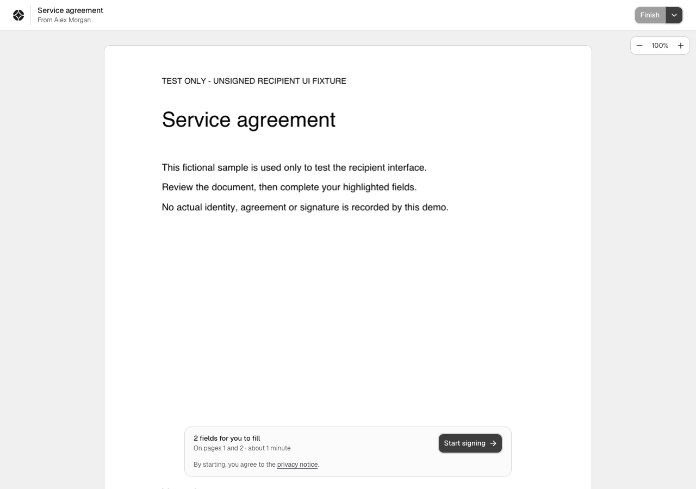
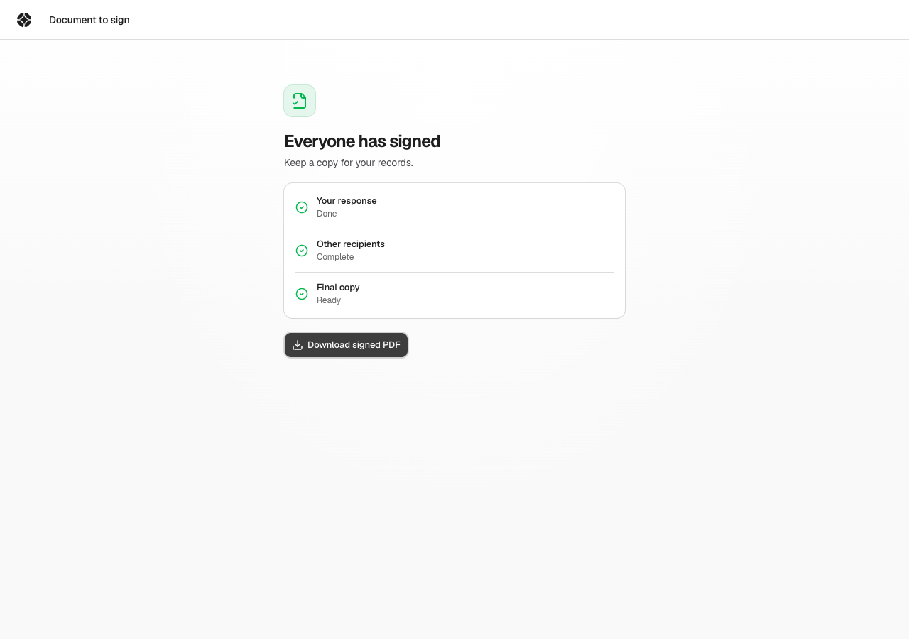

Use the private invitation sent to **your email address**. An AI Employee can prepare a request, but cannot supply your signature for you.

## Before you begin

- Confirm you recognize the sender and expected document. Contact the sender separately if anything looks unexpected.
- Use the latest invitation and the account with the invited email address.
- Review the business terms and your organization's requirements. Odella's signing screen does not provide legal advice.

## Review and sign

<Steps>
  <Step title="Open your invitation">
    Follow your own link and sign in when requested. Do not forward the link to someone else or use a colleague's invitation.
  </Step>
  <Step title="Read the document and policy">
    Check the complete document, parties, and signature meaning. Read the displayed consent before proceeding. Ask the sender to correct any error rather than signing an incorrect version.
  </Step>
  <Step title="Complete your assigned fields">
    Follow the field navigation. Enter required answers and confirm the requested name or initials. Provide your signature, or explicitly select your saved signature where offered. Other people's fields are not yours to complete. Signer email and date-signed values are recorded automatically on completion.
  </Step>
  <Step title="Review the final confirmation">
    Check your entries and finish using the signing control. Merely opening the document or choosing a saved signature does not complete signing.
  </Step>
  <Step title="Wait for the completed copy">
    Your part may finish before other recipients. Wait for all required signatures and final sealing, then use the available download control.
  </Step>
</Steps>

<Frame caption="Recipient review and consent. Synthetic Storybook example; no real document or invitation.">
  
</Frame>

## Understand the result

| Screen or state | Meaning and next step |
| --- | --- |
| Waiting for your turn | Another recipient must complete their step first. |
| Your part is complete | Your signing step is done; the envelope may still be waiting for others. |
| Preparing your copy | Final sealing is still running. Wait rather than submitting again. |
| Signing complete | Use the final download when available. |
| Declined | The request did not complete; contact the sender. |

<Frame caption="Final-copy screen. Synthetic Storybook example.">
  
</Frame>

## If you cannot continue

- **Wrong account:** Sign in with the invited email and reopen the latest invitation. Access to another Odella workspace does not make you the invited signer.
- **Expired or invalid link:** Ask the sender to check the existing request and provide a current invitation. Do not substitute another person's link.
- **Incorrect terms or recipient:** Stop and contact the sender; decline where that control is available. Do not sign on the expectation that someone will edit the completed record.
- **Service unavailable:** Reopen the same request later and check its state before repeating a completion action.
- **Download not ready:** Check whether others still need to sign or whether final sealing is underway.

## Saved signatures and records

Manage your saved signature under [Account → Profile](/platform/profile-and-account#manage-your-signature). Saving one does not authorize automatic signing. Deleting it does not change documents already signed.

Senders can find protected copies and evidence under [Signing requests and records](/documents/signing-records). A recipient invitation does not grant general access to the sender's Document Stores. Keep downloaded documents private and follow your retention policy.
