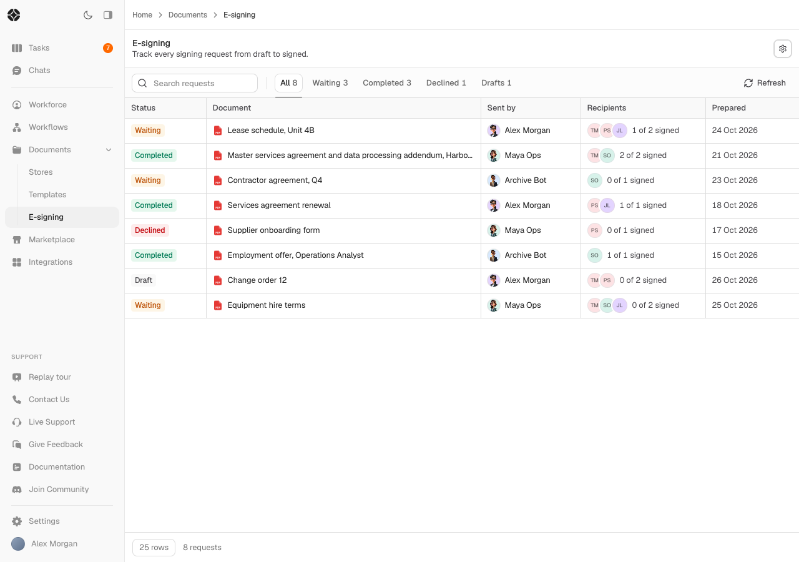

# Follow documents through signing

Use **Documents → E-signing** (the signing requests list) to follow prepared signing requests, outstanding signatures, and completed records you are authorized to view.

To configure the source template and send a request, see [E-signing](/templates/05_e-signing). Generating or downloading a draft does not itself invite recipients.

<Frame caption="Signing requests and status. Synthetic Storybook example, not live documents.">
  
</Frame>

Recipients can follow [Sign a document](/documents/sign-a-document) for their invitation and final-copy walkthrough.

## Review request status

Open a request to inspect its document, recipients, and reported progress. Use the available filters to distinguish drafts, waiting requests, completed requests, and declined requests.

- **Draft:** Prepared but not yet sent; review and one-time send approval are still required.
- **Waiting:** Check which recipients have opened or completed their part.
- **Declined:** Review the reported outcome with the sender; do not treat it as completed signing.
- **Completed:** Check that the final copy and evidence are available.

A recipient finishing their part does not mean everyone has signed. Final sealing can also take time after the last signing step; wait for the reported final state rather than relying on a progress count alone.

## Find completed records

Open the completed signing request to inspect its available final signed PDF and completion evidence. Wait for final sealing before relying on a download.

**E-signing → Save a copy (optional)** can also request an additional Document Store copy. **Signing request only** does not request that copy. Check the request's reported copy status separately, then open the selected store with appropriate permissions. A completed signature does not by itself prove the optional copy was saved.

Download the available completed copy when you need to retain or use it outside Odella.

Treat these records as sensitive: they can contain verified recipient email addresses, signatures, consent, and timestamps.

## Protected records are not knowledge-store uploads

An existing **protected signing-record store** does not support normal file uploads, cloud-folder imports, AI indexing, metadata reprocessing, replacement, or deletion of protected records. Do not use ordinary knowledge-store bulk actions to manage signing evidence.

These restrictions do not automatically apply to an ordinary Document Store selected for an optional copy. Check the actual store kind before assuming records cannot be changed or deleted.

Use **Settings → Storage** to review restrictions and **Settings → Access** in organization accounts to review the audience.

## Archive or restore a store

Where authorized, use the signing store's General settings lifecycle controls:

- Archive to stop new signing requests from using it.
- Allow already-sent requests to finish; their resulting records remain available.
- Restore to accept new requests again.

Archiving does not erase records or set an automatic retention/disposal date. Access changes apply to historical records too.

<Warning>
  Review the full audience before sharing a signing store. Changing permissions
  can expose already-completed documents, not only future requests.
</Warning>

## Troubleshooting

- **Request not visible:** Check the account, filters, and your resource access.
- **Recipient cannot sign:** Use the latest invitation and the account with the invited email address. Check the reported expiry or decline state.
- **Final copy not ready:** Distinguish waiting for other recipients from sealing the completed document.
- **New request cannot use the store:** Check whether it is archived, ready, and available to the worker/request owner.
- **Uncertain send or charge:** Inspect the existing request before retrying. See [send-time billing](/platform/billing-and-credits#e-signing).

For the standard-store lifecycle, see [Document Store settings](/documents/settings-and-integrations).
