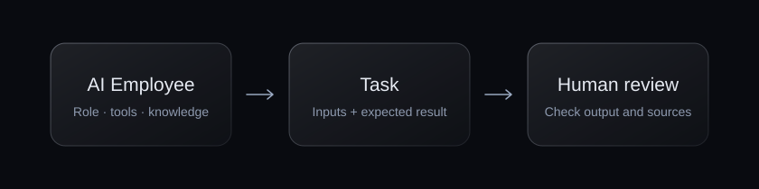

Odella helps you build and manage a team of **AI Employees**. Each worker has a role, responsibilities, access to selected resources, and a human manager. You give it an outcome to work toward, then review what it produces.

<Frame caption="The basic relationship: give an AI Employee a clear task, then review the result. Concept diagram, not a product screen.">
  
</Frame>

## Start with a worker and a conversation

Imagine an operations colleague who needs a weekly supplier report:

1. **Hire an AI Employee** with a responsibility such as supplier research and reporting.
2. **Onboard it** with approved supplier files, reporting instructions, and the tools it needs.
3. **Start a conversation**: [open Chat with the worker](/workforce/chat) and ask, “Compare these proposals and prepare a summary of costs, missing information, and questions for review.”
4. **Follow the work**: answer questions, review requested approvals, and inspect the returned answer and files.
5. **Improve the process**: refine instructions before scheduling the work or expanding access.

You do not have to create a board task or build a visual workflow before asking for work. You can also use the worker's [published communication channels](/workforce/contact-an-employee).

## Give the worker the right resources

| Resource      | What it adds                                                    | Use it when                                                    |
| ------------- | --------------------------------------------------------------- | -------------------------------------------------------------- |
| **Knowledge** | Approved files and company context the worker can reference.    | Answers should use your policies, records, or source material. |
| **Tools**     | Access to selected connected applications and their operations. | The task needs information or actions in another system.       |
| **Skills**    | Reusable instructions for a particular procedure.               | The worker should follow your team's method consistently.      |
| **Templates** | An approved PDF or Word document structure.                     | The result must follow a particular document format.           |

Assign only what the job needs. A connected application, a worker's instructions, and permission to perform an action are separate controls.

## Choose the right place for information

- **A task or conversation:** the request, clarification, and result of a piece of work.
- **The worker's Workspace:** working files, drafts, and task-specific material.
- **A Document Store:** a governed collection of reusable company knowledge.
- **Account → Vault:** protected logins and API keys—not a general document library.

## You manage the boundaries

Decide who may use the worker, who may change its settings, which tools it can use, and which supported actions need approval. Inspect the actual result before using it for consequential work.

[Access and security](/guides/access-and-security) explains these controls. Connected-tool approvals do not automatically apply to every browser action.

## Try it with one useful outcome

Start with a low-risk task and sample data. A clear request names the source, the deliverable, the constraints, and the person who will review it.

> Compare the three attached supplier proposals. Return a short recommendation with a cost table, missing information, and source references. Do not contact suppliers or update any external records. Flag uncertainties for my review.

Those instructions guide the work; use access and action policies to enforce restrictions.

[Follow the first-task guide →](/get-started/quickstart)
