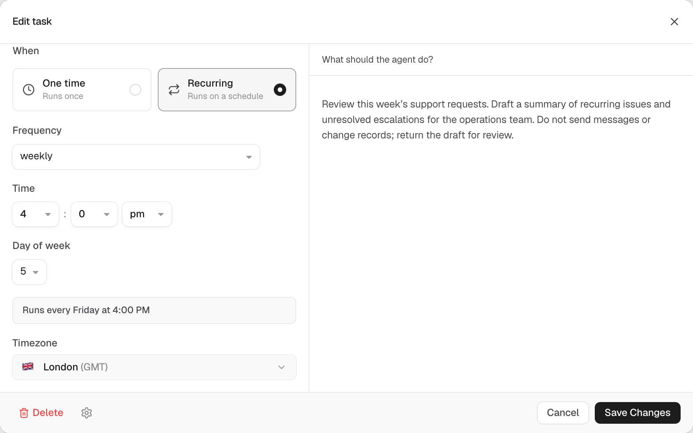

  Test it once. Then make it repeat.
  
Start with a task that already works. Ask your AI Employee to do it once, review the result, then decide when it should repeat.

  <a className="docs-guide-action" href="/workforce/calendar">Set up a schedule →</a>

## Example: a weekly support summary

1. Ask the worker to summarize a few sample support requests. Check the sources, unresolved issues, and final draft.
2. Open the worker's **Calendar**, select **New Task**, and choose **Recurring**.
3. Name it **Weekly support summary**. Set the day, time, and timezone—for example, Friday at 4 PM in London.
4. Give it the same tested instructions, including where to find the records and what needs human review.
5. Test with **Run now** where offered. Inspect the resulting task before relying on the schedule.

<Frame caption="Actual recurring-task settings with fictional draft-only instructions. The settings panel is scrolled to show the weekday and timezone; this is not evidence of a completed run.">
  
</Frame>

[Follow the illustrated schedule setup →](/workforce/calendar)

## Choose what starts the work

| Start the work…                        | Use                                                                                   |
| -------------------------------------- | ------------------------------------------------------------------------------------- |
| At a specific time, once or repeatedly | [Calendar](/workforce/calendar)                                                       |
| When a supported event occurs          | [Actions](/workforce/actions)                                                         |
| When someone asks for it               | [Tasks](/workforce/tasks) or a [connected channel](/workforce/communication-channels) |

You do not need the visual workflow builder to give an AI Employee recurring responsibilities.

## Before enabling unattended work

- Confirm the worker's manager, working hours, required connections, and permissions.
- State what it should produce and when it should ask a person for help.
- Keep required approval and outbound-recipient policies in place.
- Check the first run in [Tasks](/workforce/tasks). A saved schedule is not proof that the work completed.

When the manager changes, [review and reauthorize unattended work](/platform/manager-handover-tutorial). If the task becomes unreliable, pause the schedule and fix the underlying task before resuming it.

## Change or stop recurring work

Use Calendar to edit or disable the schedule. Review existing tasks separately: stopping future runs does not undo actions from earlier work.
