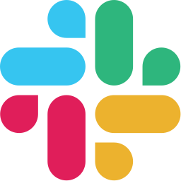
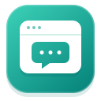
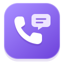
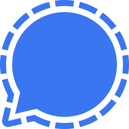
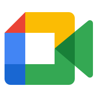

  Work in your tools. Stay in touch.
  
Start here when your worker needs information from another system or should be reachable outside Odella.

  <a className="docs-guide-action" href="/integrations/overview">Connect your first application →</a>

## Two different kinds of connection

<CardGroup cols={2}>
  <Card title="Connect a workplace tool" href="/integrations/overview">
    Let the worker read or act in an application. Connect the application,
    then assign only the tools the worker needs.
  </Card>
  <Card title="Open a contact channel" href="/workforce/communication-channels">
    Give people a way to contact the worker by email, workplace messaging,
    or another supported channel.
  </Card>
</CardGroup>

Connecting an application does not give every worker access. Publishing a channel does not authorize every sender or external action.

## Connect one application safely

1. Choose the application in **Integrations** and complete its supported sign-in flow.
2. Check the selected provider account and requested permissions.
3. [Assign its tools](/workforce/tools) only to the worker that needs them.
4. Review tool and outbound policies, then try a low-risk read with test data.

For personal connections, confirm [whose credentials are used](/platform/credentials-and-scope). Store supported logins and API keys through [Vault](/platform/vault), not in chat or instructions.

## Choose where people will contact the worker

  {/* channel-branding:start — generated by scripts/sync-channel-branding.mjs */}

  <a className="channel-logo-card" data-channel="slack" href="/workforce/channels/slack">
    
      
      Slack
      →
    
    Create the workspace app, add credentials securely, and approve its installation.
  </a>
  <a className="channel-logo-card" data-channel="teams" href="/workforce/channels/teams">
    
      
      Microsoft Teams
      →
    
    Register the Microsoft app, configure the bot, and install the Teams package with administrator help.
  </a>
  <a className="channel-logo-card" data-channel="email" href="/workforce/channels/email">
    
      
      Employee email
      →
    
    Use the employee’s generated Odella address. Incoming email is restricted to authorized members.
  </a>
  <a className="channel-logo-card" data-channel="web-chat" href="/workforce/channels/web-chat">
    
      
      Web chat
      →
    
    Configure the employee’s existing Odella conversation and optional spoken replies.
  </a>
  <a className="channel-logo-card" data-channel="whatsapp" href="/workforce/channels/whatsapp">
    
      
      WhatsApp
      →
    
    Review organization eligibility, an assigned number, and manual/provider onboarding. Not fully self-service.
  </a>
  <a className="channel-logo-card" data-channel="phone" href="/workforce/channels/phone">
    
      
      Phone and SMS
      →
    
    Assign an active, capable number and verify eligibility, compliance, routing, and calling terms.
  </a>
  <a className="channel-logo-card" data-channel="telegram" href="/workforce/channels/telegram">
    
      
      Telegram
      →
    
    Create the bot with the official BotFather, save its token securely, and test a message.
  </a>
  <a className="channel-logo-card" data-channel="discord" href="/workforce/channels/discord">
    
      
      Discord
      →
    
    Configure a developer application, bot token, gateway intents, and server installation.
  </a>
  <a className="channel-logo-card" data-channel="signal" href="/workforce/channels/signal">
    
      
      Signal
      →
    
    Use a supported assigned number, complete SMS verification, and resolve a CAPTCHA when needed.
  </a>
  <a className="channel-logo-card" data-channel="google-meet" href="/workforce/channels/google-meet">
    
      
      Google Meet
      →
    
    Confirm availability and Google authorization with support. A saved meeting link is not proof of access.
  </a>

{/* channel-branding:end */}

Channel availability varies by account. [Compare setup requirements](/workforce/communication-channels) before connecting; a listed guide is not confirmation that a channel is available.

Set [inbound access, outbound recipients, and approvals](/workforce/settings-security-privacy) before testing external communication. Phone-based channels may also need an [assigned number](/platform/phone-numbers).

## Need a custom or developer connection?

- [Custom integrations](/integrations/custom-integrations): connect a remote MCP server for workers to use.
- [Odella MCP server](/integrations/mcp-server): use Odella from an external client such as Claude Code, Codex, or Cursor.

These are different directions of access. Review the endpoint, authentication, permissions, and data handling before connecting either.
