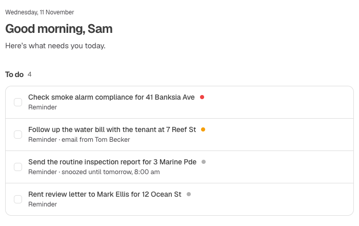

The **Brief** is the starting pane inside [Inbox](/inbox/overview). It summarizes available personal actions and reminders; it is not a guaranteed inventory of all email, work, or business deadlines.

<Frame caption="The daily Brief's To do list. Synthetic Storybook example.">
  
</Frame>

## Work through To do

1. Open Inbox without selecting a conversation. Return from a message using Back or by reselecting the current view.
2. Review **To do** and each item's source and timing. Follow a source link to check the actual message before acting.
3. Mark an action done only when the responsibility is complete. Clearing an item is not evidence that an external business action happened.
4. Use **Snooze** where offered for a reminder. Check the displayed time; snoozing a reminder does not change a business deadline.
5. Use **Hand off** to choose an AI Employee and create work. Check the resulting [task](/workforce/tasks); acceptance is not completion.

On a phone, additional actions may be under **More**. Controls appear only when their backing operation is available.

## Labels, reminders, and scope

Where label-based inclusion is available, review **Include in daily Brief** in the label settings. Automatic classification is not a human-confirmed priority decision. Labels that were never opted in should not be assumed to feed the Brief.

The available Brief projection determines which commitments, reminders and sources appear. Employee work, approvals and arbitrary high-priority mail are not guaranteed to appear as To do rows. Check [Tasks](/workforce/tasks), [Approvals](/workforce/approvals), and the native mailbox separately when needed.

Reminder windows are notification timing, not confirmed due dates. Displayed times depend on your timezone. New connections need history collection and analysis before useful items can appear; an empty list does not certify that you have no obligations.

## Troubleshooting

- **An item is wrong:** Open the source and correct the underlying work or label using the available controls.
- **Hand off reports a problem:** Check whether a task was already created before submitting again.
- **A change reappears:** The update may have failed. Check the message shown and current state rather than repeatedly clearing it.
- **Brief cannot load:** Retry; do not rely on an old screenshot or cached list as today's complete work.

Insights is a separate organization feature; a personal Brief does not grant access to [account-wide Insights](/inbox/insights).
