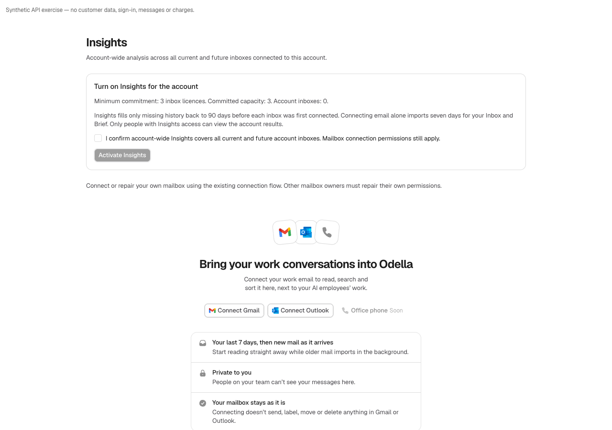

Open **Insights** from the Inbox header when available. Insights requires an **organization account** and permission to view it. Your personal Inbox and Brief remain separate; switching to a personal account does not expose organization Insights.

## Activate deliberately

Insights covers **all current and future inboxes connected to the account**, subject to mailbox connection permissions. It is not a private toggle for only your mailbox. Only someone with permission to manage Insights can activate, pause, or resume it.

<Steps>
  <Step title="Review eligibility and capacity">
    Check the displayed minimum inbox commitment, committed capacity, and account inbox count. Account entitlement and enough committed capacity are prerequisites to activation. Do not infer a price or automatic purchase from a screenshot.
  </Step>
  <Step title="Acknowledge the account-wide scope">
    Read and confirm the current-and-future-inbox acknowledgement. Review your organization's authorization and privacy requirements before proceeding.
  </Step>
  <Step title="Request or activate">
    Select **Request activation** if entitlement/capacity is not ready, or **Activate Insights** when eligible. A request does not by itself turn on analysis or create a charge. Follow the commercial terms presented for your account.
  </Step>
  <Step title="Check preparation">
    Review each mailbox's connection and history state. Owners must repair their own provider permissions. Wait for preparation before treating results as representative.
  </Step>
</Steps>

<Frame caption="Account-wide Insights activation and capacity. Synthetic Storybook example, not a price quote or live result.">
  
</Frame>

## Understand preparation states

| State | What to check |
| --- | --- |
| Reconnect or grant mailbox access | The mailbox owner needs to complete its connection flow. |
| Waiting for initial inbox import | Verify the initial Inbox collection has started. |
| Collecting missing history | The stated history window is still being filled. |
| Analysing collected messages | Collection is not the same as completed analysis. |
| History analysed | That mailbox's preparation is ready; check other mailboxes too. |
| Needs attention | Review the reported failure; automatic retries may still be enabled. |
| Paused | Review account/source state before resuming. |

Insights fills missing history to the window displayed for each inbox, measured from when it was first connected. Ordinary email connection's initial Inbox/Brief import is not proof that the longer Insights history is ready. **Some inboxes are ready** is partial coverage, not a complete-account result.

## Pause, resume, and retry

With management permission, review the account-wide acknowledgement and use **Pause Insights**, **Resume Insights**, or **Retry preparation** as offered. Recheck capacity before resuming. Pausing does not disconnect provider accounts, erase retained records, or revoke everyone's access.

If status cannot load, retry rather than assuming the previous state is current. Viewing permission does not include management permission; contact an authorized manager for changes.

## Result limitations

Activation and history readiness do not certify the completeness, accuracy, or general availability of every chart, benchmark, finding, or response-time view. Some UI examples are design fixtures. Use only results actually returned for your authorized account, check their source/coverage, and validate conclusions before business decisions. Do not interpret synthetic screenshots as measured employee performance.

See [organization permissions](/platform/roles-and-permissions), [Inbox setup](/inbox/overview), and [billing and credits](/platform/billing-and-credits) for the separate access, connection, and funding controls.
