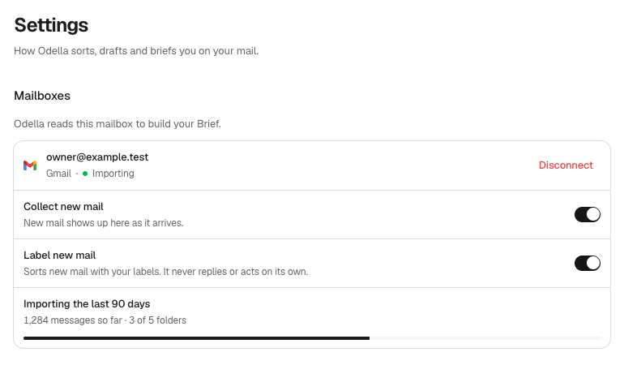
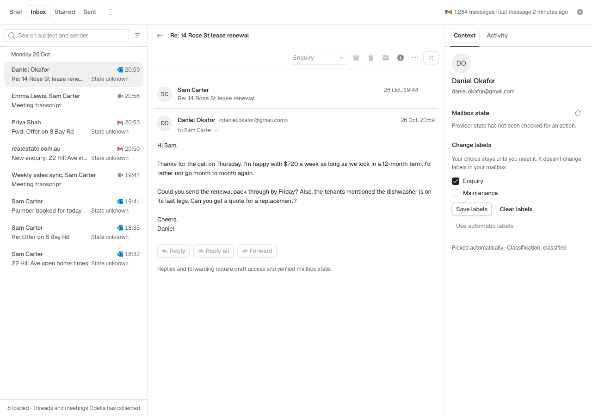

**Inbox** brings collected messages and your [daily Brief](/inbox/daily-brief) into one workspace. It is distinct from an AI Employee's [email channel](/workforce/channels/email): connecting your mailbox does not publish an employee email address or automatically authorize autonomous replies.

<Note>
  Inbox is available only where enabled for your account. Controls also depend on mailbox/provider capabilities and your permissions. Screenshots are synthetic UI illustrations, not evidence that every account has these features.
</Note>

## Connect and check your mailbox

1. Open **Inbox** and choose Gmail or Outlook in the connection flow.
2. Review provider permissions and authorize the intended mailbox yourself.
3. Return to Odella and select **Check connection and import** when offered. Opening or finishing an OAuth window is not by itself confirmation that collection is ready.
4. Check the mailbox's connected state and import progress in Inbox settings. Resolve a reconnect or import error before assuming messages are current.

Connecting email imports the supported initial history window for Inbox and Brief. The current flow describes seven days; check the window and progress shown for your mailbox. Imported-message counts are progress, not a whole-mailbox total or delivery guarantee. [Insights](/inbox/insights) has separate organization-wide activation and history preparation.

<Frame caption="Mailbox collection and import settings. Synthetic example with a longer configured history window, not the default seven-day initial import.">
  
</Frame>

## Read and find conversations

Select a conversation to open it. Use search and the available source, label, and folder controls. Search and conversation links preserve navigation context; they do not grant someone else permission to read your mail. Search terms can appear in browser history and shared URLs.

Inbox is collected history, not a promise to display every message in the native mailbox. Starred, Sent, Archive, Trash and other views operate on supported, verified collected messages. An unavailable folder is not an empty folder. Use the native provider when you need complete mailbox coverage.

<Frame caption="The collected-message reader. Synthetic Storybook example.">
  
</Frame>

## Compose, reply, and send

Where enabled, choose **Compose**, **Reply**, **Reply all**, or **Forward**. Check the From mailbox, To/Cc/Bcc, body, signature, and attachments. Wait for provider-backed saving before sending. Saved-contact suggestions are mailbox-specific; enter addresses manually if contact permissions are unavailable.

Drafts and sending use the connected provider. A send acknowledgement means the provider accepted it—not that the recipient received it. If the result is uncertain, check native Drafts and Sent before trying again. Never create a second message just to work around an unknown send result. Live Undo and scheduled sending are not implied by the presence of a draft editor.

Writing assistance, where offered, operates on explicitly selected text or recorded dictation. Review the result; it does not send the message.

## Message actions and bulk work

Use supported read/unread, star, Archive, Move to Inbox, and Trash controls. Actions can be unavailable for meetings, unsupported sources, stale messages, or read-only access. Archive does not silently restore a trashed message.

To select conversations, use a row's context menu → **Select conversation**, then the **N selected** menu. Current bulk limits are 20 conversations and 100 collected messages. Bulk operations are not atomic: some messages may succeed before another fails. Review confirmed, unconfirmed, and unattempted results. Refresh or inspect the native mailbox rather than assuming rollback or retrying the whole selection.

## Settings and automation

Open the header's settings control to review the available sections:

- **Mailboxes:** connection, collection, import progress, reconnect and disconnect.
- **Labels:** classification and the available daily-Brief inclusion choices. Review automatic labels; manual corrections matter.
- **Email signatures:** maintain a signature per mailbox. Gmail import is explicit; use the supported custom signature editor where provider import is unavailable.
- **Forwarding rules:** explicit event [Actions](/workforce/actions) on selected employees. Inspect the provider, employee, filter, instructions and enabled state. These are not a blanket grant to every mailbox or employee.

Changing collection is separate from granting an employee authority to send mail. Read the disconnect confirmation carefully: retention/removal choices differ from merely pausing collection. Do not assume disabling a rule revokes the underlying provider authorization.

## Recovery

- **Recent mail is missing:** Inspect connection/import status and collection window, then check the native mailbox. Collection can lag.
- **A source is paused:** Review its settings; pausing does not prove retained messages were deleted.
- **Content cannot load:** Retry the reported read after checking access. A list entry does not guarantee its body or attachment remains available.
- **A write is uncertain:** Stop repeated writes and verify the exact message in the provider.
- **Inbox is absent:** Ask your administrator or support about account availability; do not change browser flags as a workaround.
