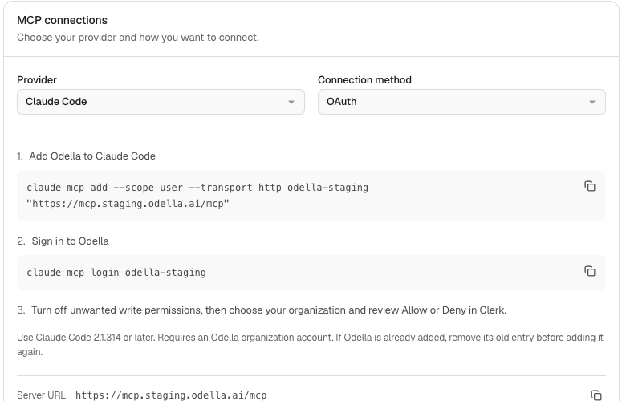
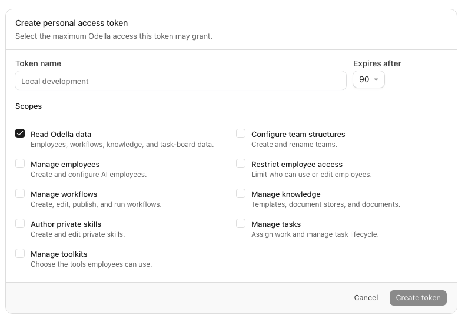

# Connect your tools to Odella

The Odella MCP server lets compatible assistants and developer tools work with your Odella account. Read workforce information, prepare workflows and templates, or assign tasks without leaving your preferred tool.

MCP (Model Context Protocol) is a standard for connecting these tools to services. Odella provides a remote **Streamable HTTP** endpoint:

```text
https://mcp.odella.ai/mcp
```

<Note>
  This connects an external client **to Odella**. To connect an external MCP
  server for your AI Employees to use, see [Custom
  integrations](/integrations/custom-integrations).
</Note>

## Choose how to connect

Open **Account → Developer**, select your client, and follow the instructions shown for your deployment. Use the endpoint displayed there if connecting to a non-production environment.

| Client | Connection method |
| --- | --- |
| Claude web and ChatGPT | OAuth, where configured; requires an Odella organization account |
| Claude Code, Codex, Cursor | OAuth where configured, or personal access token |
| OpenCode | Personal access token |

OAuth signs you in through your browser without copying a token. A personal access token is a manually managed secret. Do not mix PAT headers with an OAuth connection; remove the old client entry or PAT configuration before switching.

## Connect with OAuth

OAuth availability is deployment-specific. If Developer settings says the provider is not configured, choose an available method rather than inventing client credentials. Each person connects using their own Odella identity.

<Tabs>
  <Tab title="Claude">
    1. In Claude web, open **Customize → Connectors → Add → Add custom connector**.
    2. Name it **Odella** and enter `https://mcp.odella.ai/mcp`.
    3. Choose **Sign in now** and **Use Claude's published identity**. Leave client credentials and request headers empty.
    4. Add the connector, select **Connect**, and sign in to Odella.
    5. Turn off unneeded write permissions, choose the intended organization, and review **Allow** or **Deny**.

    Use the web connector, not a local desktop extension. Connector availability depends on Claude's plan and workspace policies.
  </Tab>
  <Tab title="ChatGPT">
    1. Open **Plugins** (**Apps** in some versions), then **Add → Add custom MCP server**. Availability depends on your plan and workspace.
    2. Name it **Odella** and enter `https://mcp.odella.ai/mcp`.
    3. Select **OAuth**. In advanced OAuth settings, choose **Client Identifier Metadata Document (CIMD)** and verify `https://chatgpt.com/oauth/client.json`—not the Codex identity.
    4. Leave client secrets and PAT headers empty. Leave discovered OAuth/OpenID settings unchanged.
    5. Connect, sign in, choose your organization, and disable unnecessary write permissions before allowing access.

    ChatGPT requests your email for authorization-domain ownership verification; this does not grant access to your Odella profile or metadata. Labels in ChatGPT may change; use the matching remote MCP app controls.
  </Tab>
  <Tab title="Claude Code">
    Use Claude Code **2.1.314 or later**. Remove an existing Odella entry before replacing its authentication method.

    ```bash
    claude mcp add --scope user --transport http odella "https://mcp.odella.ai/mcp"
    claude mcp login odella
    ```

    Complete browser sign-in and consent, then run `/mcp` inside Claude Code.
  </Tab>
  <Tab title="Codex">
    Use Codex **0.166.0 or later**.

    ```bash
    codex mcp add odella --url "https://mcp.odella.ai/mcp"
    ```

    Follow the browser authorization flow offered by your client. Review the organization and write permissions, then check `/mcp` inside Codex. Remove any existing PAT configuration first.
  </Tab>
  <Tab title="Cursor">
    In **Account → Developer**, choose **Cursor → OAuth** and copy the generated configuration. It includes the registered `auth.CLIENT_ID`; use the value supplied by your deployment rather than a made-up ID. Merge it into `.cursor/mcp.json`, then open **Cursor Settings → Tools & MCP** and connect to complete browser sign-in. Remove the old Bearer-token header first.
  </Tab>
</Tabs>

<Frame caption="OAuth setup in Developer settings. Synthetic Storybook staging example; use the production endpoint above for production.">
  
</Frame>

Consent never overrides your current account or resource permissions. Start with read access and test the connection before enabling writes. Disconnect a hosted connector in its client to stop using it; contact support if you need outstanding OAuth grants revoked. Revoking a PAT does not revoke a separate OAuth grant.

## Create a personal access token

<Steps>
  <Step title="Open Developer settings">
    In Odella, go to **Account → Developer**, then select **Create token**.
  </Step>
  <Step title="Choose access and expiry">
    Give the token a recognizable name. Choose **30 days**, **90 days**, or **1
    year**, and select only the scopes your client needs. **Read Odella data**
    is included by default.
  </Step>
  <Step title="Copy the token">
    Copy it before closing the confirmation. Odella shows the token only once.
    Store it securely; create a replacement if you lose it.
  </Step>
</Steps>

A token is tied to your user and account. It cannot grant more access than you currently have in Odella. Your current permissions and account policies still apply to every request, even when a token includes a write scope.

<Frame caption="Creating a least-privilege token, shown with Storybook example data. No real credential is displayed.">
  
</Frame>

## Connect with a personal access token

For the examples below, set your token in the environment where your client starts:

```bash
export ODELLA_API_TOKEN="<YOUR_PERSONAL_ACCESS_TOKEN>"
```

<Tabs>
  <Tab title="Claude Code">
    Add Odella to your project:

    ```bash
    claude mcp add --scope project --transport http odella "https://mcp.odella.ai/mcp" --header "Authorization: Bearer $ODELLA_API_TOKEN"
    ```

    Run `/mcp` inside Claude Code to check the connection.

    <Warning>
      The shell expands the token in this command. Treat the resulting local configuration as a secret and do not commit it to version control.
    </Warning>

  </Tab>
  <Tab title="Codex">
    Add the remote server:

    ```bash
    codex mcp add odella --url "https://mcp.odella.ai/mcp"
    ```

    In `~/.codex/config.toml`, add the environment-variable setting to the Odella entry:

    ```toml
    [mcp_servers.odella]
    url = "https://mcp.odella.ai/mcp"
    bearer_token_env_var = "ODELLA_API_TOKEN"
    ```

    Run `/mcp` inside Codex to verify the connection.

  </Tab>
  <Tab title="Cursor">
    Set `ODELLA_API_TOKEN` in the environment where Cursor starts, then add this to `.cursor/mcp.json`:

    ```json
    {
      "mcpServers": {
        "odella": {
          "url": "https://mcp.odella.ai/mcp",
          "headers": {
            "Authorization": "Bearer ${env:ODELLA_API_TOKEN}"
          }
        }
      }
    }
    ```

  </Tab>
  <Tab title="OpenCode">
    Add this remote server to `opencode.json`:

    ```json
    {
      "$schema": "https://opencode.ai/config.json",
      "mcp": {
        "odella": {
          "type": "remote",
          "url": "https://mcp.odella.ai/mcp",
          "enabled": true,
          "headers": {
            "Authorization": "Bearer {env:ODELLA_API_TOKEN}"
          }
        }
      }
    }
    ```

  </Tab>
</Tabs>

For other clients, choose a remote Streamable HTTP server and send `Authorization: Bearer <YOUR_PERSONAL_ACCESS_TOKEN>` with requests. Merge these examples into existing configurations rather than replacing other servers.

## Choose token scopes

| Scope                             | Purpose                                                                              |
| --------------------------------- | ------------------------------------------------------------------------------------ |
| `odella:read`                     | Read Odella context, AI Employees, workflows, templates, Document Stores, and tasks. |
| `odella:organization:teams:write` | Create and rename teams.                                                             |
| `odella:employees:write`          | Create and configure AI Employees.                                                   |
| `odella:employees:access:write`   | Restrict who can use or edit AI Employees.                                           |
| `odella:workflows:write`          | Create, edit, publish, and run workflows.                                            |
| `odella:knowledge:write`          | Manage templates, Document Stores, and documents.                                    |
| `odella:skills:write`             | Create and edit private skills.                                                      |
| `odella:tasks:write`              | Assign work and manage task lifecycle.                                               |
| `odella:integrations:write`       | Configure the toolkits AI Employees can use.                                         |

Some operations require more than one scope. The tools available to your client depend on the token's scopes; having a scope does not override your permissions on a particular resource.

## Test the connection

Start with a read-only token and ask your client to:

- “Show my Odella account context.”
- “List the AI Employees I can access.”
- “Show the published templates available in Odella.”

The client can use `odella_get_context`, `employees_list`, and `templates_list` for these checks. Review results before granting write access or asking the client to publish, delete, or change business data.

## Configure workers and assign work

See [MCP work recipes](/integrations/mcp-recipes) for revision-safe instruction updates, targeted resource assignments, task creation, private file uploads, template preparation, private-skill publication, and disabled Action staging. The guide includes required scope combinations and safe recovery from uncertain mutations.

## Revoke or replace a token

Return to **Account → Developer** to review your tokens and revoke any you no longer need. Revocation takes effect on the next request. To rotate a token, create a replacement, update your client's secret, verify the connection, then revoke the old token.

<Warning>
  Treat personal access tokens like passwords. Never include them in prompts,
  screenshots, shared configuration, or source control. Revoke an exposed token
  immediately.
</Warning>

## Troubleshooting

- **Authentication fails:** Check that the token is complete, has not expired or been revoked, and is sent as a Bearer token. Confirm that your client can read its environment variable.
- **OAuth is unavailable:** Check the chosen provider in Developer settings and confirm you are using an organization account. Hosted Claude/ChatGPT connectors do not use PAT headers.
- **Consent used the wrong organization:** Stop before performing writes; reconnect and choose the intended organization.
- **An OAuth connection fails after using a PAT:** Remove the old Bearer header/client entry and repeat the displayed OAuth setup. Never add a client secret unless your displayed instructions explicitly require it.
- **A tool is missing:** Check the token's scopes. Create a replacement with the required scopes if necessary, then refresh the client's tool list.
- **An operation is denied:** Confirm your current account membership, resource access, and account policies. A broader token cannot bypass these controls.
- **The server is unavailable:** Confirm the URL is `https://mcp.odella.ai/mcp`, not the dashboard URL. If the problem persists, contact [support@odella.ai](mailto:support@odella.ai) without including your token.
