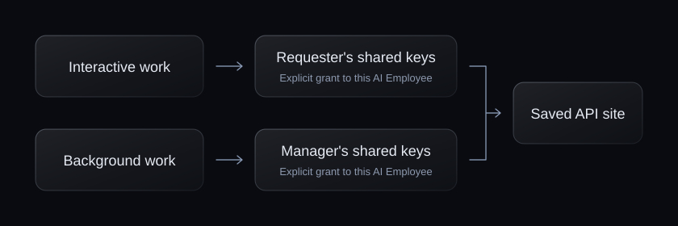

An AI Employee needs both permission to do the work and an authorized connection to the application involved. These are separate checks: a working connection is not permission to use every tool or access every Odella resource.

## User-based and account-based connections

An integration's defined scope determines which connection Odella looks up. Both kinds remain within the relevant Odella account.

| Connection scope | Whose connection is used? | Typical purpose |
| --- | --- | --- |
| **User** | The connection belonging to the person identified for the work, within that account. | Work with a person's authorized application identity. |
| **Account** | The account's connection for that integration. | A shared organizational service connection. |

Scope is defined by the integration, not selected by the AI Employee in a prompt. Account scope does not mean every member or worker may use the connection: resource access, assigned capabilities, and applicable policies still matter.

<Note>
  An account-scoped integration connection is not the same thing as a personal Vault item. [Vault](/platform/vault) items belong to an individual within an account and require explicit sharing before an AI Employee can use an API key.
</Note>

## How user scope is determined

### Work requested by a signed-in person

For interactive work, Odella uses the verified user associated with the active conversation or session. The AI Employee does not choose a user from the text of a message.

For a user-scoped integration, this means looking up that person's connection in the account. For an account-scoped integration, Odella looks up the account connection instead.

For example, if Alex asks a worker to use a user-scoped application, the worker uses Alex's connection—not the manager's connection just because the manager has broader access.

### Background and unattended work

Scheduled and event-based work needs an accountable identity even when no person is actively chatting. For governed AI Employees, the manager supplies the user scope recorded when automation is authorized.

That user scope identifies whose user-based connections the work can use. The automation itself operates under a separate, scoped authorization for its work; it does not become an unrestricted session for the manager.

### Messages from outside the account

An admitted external contact is not automatically an account member. Where a channel establishes a verified member identity, that identity can supply user scope. Otherwise, the employee's assigned manager supplies credential scope while the contact's work remains limited by its channel admission.

Receiving a message therefore does not give the sender the manager's general account permissions. Review inbound access, assigned tools, and approval requirements before exposing a worker to external contacts.

### No valid identity or authorization

Odella refuses work or credential use when the required identity or authorization cannot be established. An invalid automation authorization does not fall back to a more privileged user session.

<Warning>
  The manager is a fallback for work without a member's interactive identity—not a fallback when a member's connection is missing, expired, or denied. Reconnect the correct person's application rather than expecting the worker to borrow someone else's connection.
</Warning>

## Credentials do not replace permissions

A successful action can depend on all of the following:

- The person or authorized work being allowed to use the AI Employee.
- The worker having the required tool or resource assigned.
- A connection existing in the integration's required scope.
- The connected provider granting the necessary permissions.
- Applicable tool, messaging, and human-approval policies allowing the action.

A manager assignment does not expand an OAuth authorization, change a provider's roles, or connect an application that has not been authorized.

## Vault keys follow an explicit owner rule

For API keys shared through Vault, an authorized interactive conversation uses the requester's shared keys. Background work and admitted external work without a member identity use the manager's shared keys. If neither person can be established, the work cannot use Vault keys.

In every case, the key must belong to that person in the same account and be explicitly shared with that AI Employee. A manager assignment alone does not share every key in the manager's Vault.

See [Vault and protected credentials](/platform/vault) for sharing, destination restrictions, and read-only access.

<Frame caption="Vault API-key scope only: interactive work uses the requester's explicit grants; background work uses the manager's explicit grants. This does not transfer the owner's general permissions or describe every integration's connection model.">
  
</Frame>

## Handover and troubleshooting

| Situation | What to review |
| --- | --- |
| A connection works for one member but not another | Check whether the integration is user-scoped and whether each person has connected it. |
| Chat works but scheduled work fails | Review the manager's connection, manager assignment, and automation authorization. |
| A provider rejects an action | Check provider permissions and reconnect requirements as well as Odella permissions. |
| A Vault key is unavailable | Check the current requester or manager, account, explicit employee grant, website, and key authentication settings. |
| The manager changes or leaves | Review connections and shared Vault keys, then review and reauthorize affected automations. |

Continue with [Manager responsibilities](/workforce/manager-responsibilities), [Worker governance](/workforce/governance), and [Security & Privacy settings](/workforce/settings-security-privacy).
