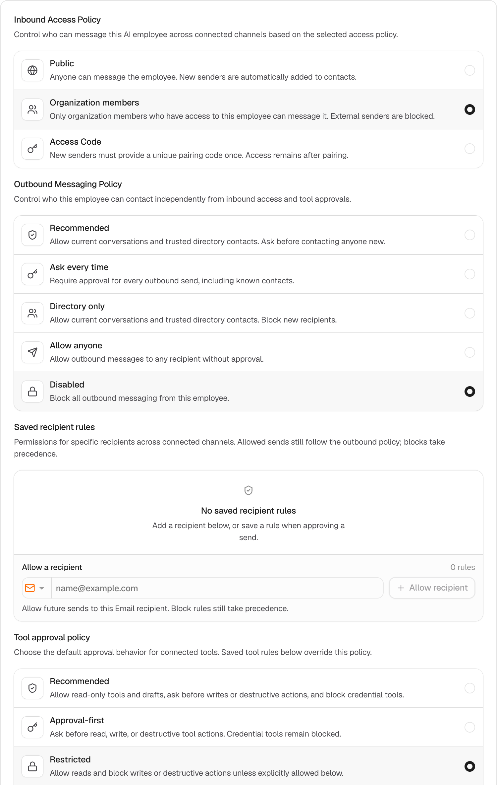

Give a Finance team help reviewing invoices without authorizing changes to accounting records, payments, or outbound messages.

**Example task:** “Summarize overdue invoices from the test ledger and identify entries for a human to review.”

This is a configuration and validation exercise. Use test records first; it is not a claim that every third-party accounting tool is read-only or production-verified.

## Before you start

You need permission to manage teams and roles, configure the worker's governance and tools, and connect an approved provider account. Start with the [team-restricted worker tutorial](/platform/secure-employee-tutorial) if these controls are new to you.

Choose an accountable Finance manager and a provider account or API key that the provider itself restricts to reading the necessary records. Do not use an accounting administrator login for convenience.

<Steps>
  <Step title="Limit the human audience">
    Create a **Finance** team and a **Finance reader** team role. Select **View employee**, **Chat with employee**, and **Request work** only. Add the intended colleagues and assign Finance reader inside Finance.

    In **AI Employee → Settings → Governance**, choose Finance as the primary audience and Finance reader as the required role. Assign the accountable manager and keep conversation sharing off. Under **Who can edit**, choose **Manager and selected editors** with no additional editors. The manager and authorized organization administrators retain editing authority.

    This controls who can ask for work; it does not establish that the worker's external access is read-only. Managers and people with broad employee-administration access retain applicable access.

  </Step>
  <Step title="Assign only the necessary resources">
    Assign the invoice knowledge and approved lookup tools needed for the task. Do not add unrelated stores, payment tools, broad custom integrations, or workflows that change records.

    Keep sensitive source material out of unrelated shared stores and conversations. A worker may summarize data it is legitimately given; read-only access does not prevent disclosure through its answers to authorized users.

  </Step>
  <Step title="Use provider-side read permissions">
    Connect a test provider identity that cannot create, edit, delete, pay, or refund records. Review the provider's actual permissions rather than relying on an Odella role name.

    For a [Vault API key](/platform/vault), save the API website and explicitly grant the worker **Read only**. This limits the protected connection to `GET` and `HEAD`. Also use a provider-side read-only key: HTTP methods alone do not prove that an API has no side effects.

    An interactive member's request uses that member's applicable connection or explicitly shared key. Governed unattended work can use the manager's credential scope. Verify both if you intend to support both; a member's missing connection does not fall back to the manager's connection.

  </Step>
  <Step title="Block ordinary connected writes">
    In **Security & Privacy**, choose:

    - **Inbound Access Policy → Organization members** for the pilot.
    - **Tool approval policy → Restricted**.
    - **Outbound Messaging Policy → Disabled**.

    Review all saved tool and recipient exceptions. Remove allow rules that conflict with the intended restriction, and explicitly block tools that must never be used. Restricted is not a substitute for narrow tool assignments and provider permissions.

    Do not enable signed-in accounting website work for this example. Connected-tool restrictions do not establish that browser actions or every other execution path are read-only. Read [Tool and browser boundaries](/platform/tool-and-browser-security).

  </Step>
  <Step title="Test without real financial consequences">
    Use a test ledger, a non-administrator colleague session, and disposable records. Do not test payment restrictions by attempting a real payment.

    Record the exact tool and operation tested. A display name such as “lookup” is not sufficient evidence of its behavior.

  </Step>
</Steps>

<Frame caption="Cropped actual Odella policy controls set to Disabled outbound messaging and Restricted tools in a synthetic local form. No settings are saved, and this does not demonstrate provider-side read-only enforcement.">
  
</Frame>

A screenshot of these controls is not an acceptance test. Independently confirm the provider account or API key is read-only, then perform the allowed and denied operations in the checklist below.

## Acceptance checklist

| Test                                                                               | Expected result                                                                                                    |
| ---------------------------------------------------------------------------------- | ------------------------------------------------------------------------------------------------------------------ |
| Finance member with Finance reader asks for an invoice summary                     | Can use the worker; the approved read tool returns only records allowed by the provider identity.                  |
| Member outside Finance opens a copied worker link                                  | Cannot qualify through the Finance primary-audience rule. Review manager/admin and other grants if access remains. |
| Ordinary Finance reader attempts to edit tools or approvals                        | Cannot edit under the manager-only policy.                                                                         |
| Worker attempts an ordinary connected record update with no allow exception        | Blocked by Restricted, not silently executed.                                                                      |
| A protected Vault request uses `POST`, `PUT`, `PATCH`, or `DELETE` under Read only | Refused by the protected connection's method restriction.                                                          |
| Provider identity is checked independently                                         | Provider settings show no write/payment authority; test only against a safe fixture if a provider check is needed. |
| Worker attempts supported outbound messaging                                       | Blocked by Disabled.                                                                                               |
| Another member lacks the required user connection                                  | Receives a connection failure or setup requirement, not access through the manager's interactive connection.       |

If a write succeeds, stop the pilot. Review saved exceptions, the actual tool policy, the operation's classification, other execution paths, and provider permissions before retrying. Do not treat changing the worker's instructions to “read only” as the fix.

## Review and offboard

- Record the manager, team-role rule, assigned resources, provider identity, and tested operations.
- Repeat the tests after changing tools, provider scopes, saved exceptions, or governance.
- Remove obsolete team-role assignments and any separate grants when responsibilities change.
- Remove Vault grants, disconnect unnecessary integrations, and revoke provider credentials separately when appropriate.
- Reassign managers before departure and reauthorize unattended work deliberately. Follow [Hand over an AI Employee](/platform/manager-handover-tutorial).

Removing access does not delete previously produced reports or undo completed provider actions. Review those records through your normal retention and incident processes.
