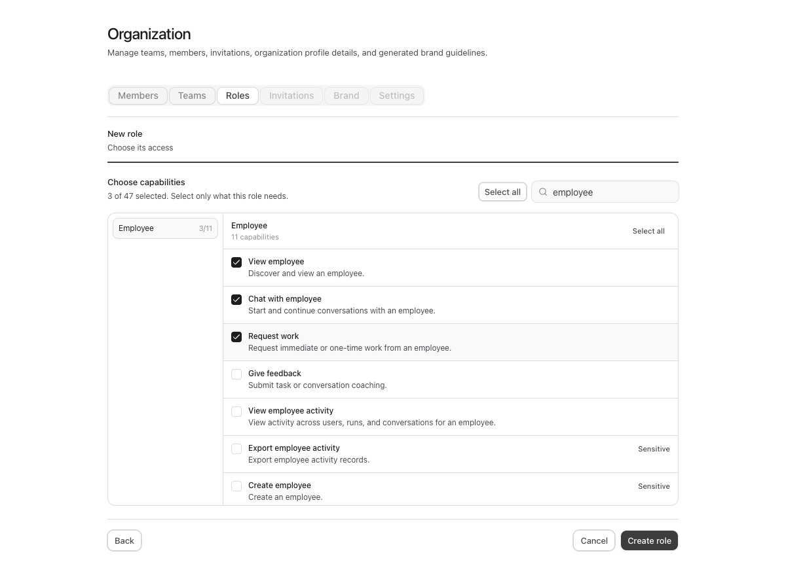

Odella separates account-level capabilities from access to individual resources. Being able to view a worker does not necessarily mean you can change their instructions, manage billing, or inspect another person's conversation.

<Tip>
  For a worked example with screenshots, follow [Create a team-restricted AI
  Employee](/platform/secure-employee-tutorial). For definitions of capabilities
  and access control lists (ACLs), read [How access control
  works](/platform/access-control).
</Tip>

## The access layers

| Layer                         | Question it answers                                                                  |
| ----------------------------- | ------------------------------------------------------------------------------------ |
| **Organization membership**   | Does this person belong to the active organization?                                  |
| **Roles and capabilities**    | Which kinds of operations may they perform?                                          |
| **Team membership**           | Which organizational groups do they belong to?                                       |
| **Resource access**           | Can they access this particular worker, store, or shared resource?                   |
| **Worker governance**         | Who manages this worker, who can edit which areas, and how are conversations shared? |
| **Channel and tool policies** | Who can contact the worker, and which actions need approval?                         |

A role, team, or saved approval rule is not a shortcut around the other applicable controls.

## Review or create a role

1. Open **Account → Organization → Roles**.
2. Select **New role**, then choose **Organization role** for organization-wide responsibilities or **Team role** for a person's responsibilities inside one team.
3. Continue to enter a name and description, then choose capabilities by category. For example, a colleague who needs to work with an AI Employee may need **View employee**, **Chat with employee**, and **Request work**, without activity-export or access-management permissions.
4. Select **Create role**. For a team role, open **Teams → your team → Manage** in the members section, add the person, and choose the role they hold in that team. Save the membership changes.
5. Configure the worker's primary audience and required role in **Settings → Governance**. Creating or assigning a role does not automatically place a worker in a team.
6. Test the intended resource as an ordinary member and as someone who should be denied. Do not verify a restricted audience only with an administrator's session.

Use recognizable business names and a description of the role's responsibility. Review the impact on current assignments before changing or deleting an existing role.

<Frame caption="Actual capability editor from the synthetic team-restriction walkthrough. Review the individual capabilities and scope, not only the role name.">
  
</Frame>

## Share a resource

For a Document Store in an organization account, open **Settings → Access**. For an AI Employee, open **Settings → Governance**. Review the primary audience and any additional access rules offered by that resource.

For example, a Customer operations team can be the audience for a worker, while only selected editors can change its instructions. The worker can still require approval before sending a customer email.

<Warning>
  Giving someone access to a signing store can expose previously completed
  signing records too. Check the full record audience, not just future requests.
</Warning>

## Access is not editing

Worker governance can restrict editing to the manager and selected people or team-role combinations, with different permitted settings areas. An editing assignment does not itself grant access to the worker. See [Worker governance](/workforce/governance).

Similarly, a manager assignment is an accountable governance role, not merely a profile label. It does not automatically authorize every unrelated account operation or third-party application.

## Diagnose a permission problem

Check in this order:

1. Correct signed-in user and active organization.
2. Current membership and relevant role assignment.
3. Team membership if the resource uses a team audience.
4. Access to the specific resource.
5. Permission for the specific operation or settings area.
6. Applicable channel, tool, account, or provider restrictions.

A personal access token cannot exceed these permissions. Its scopes are an additional limit, not a replacement for authorization. See [MCP server](/integrations/mcp-server).

Review access when people join, change responsibilities, or leave. Start with narrow grants and document who owns each shared resource.
