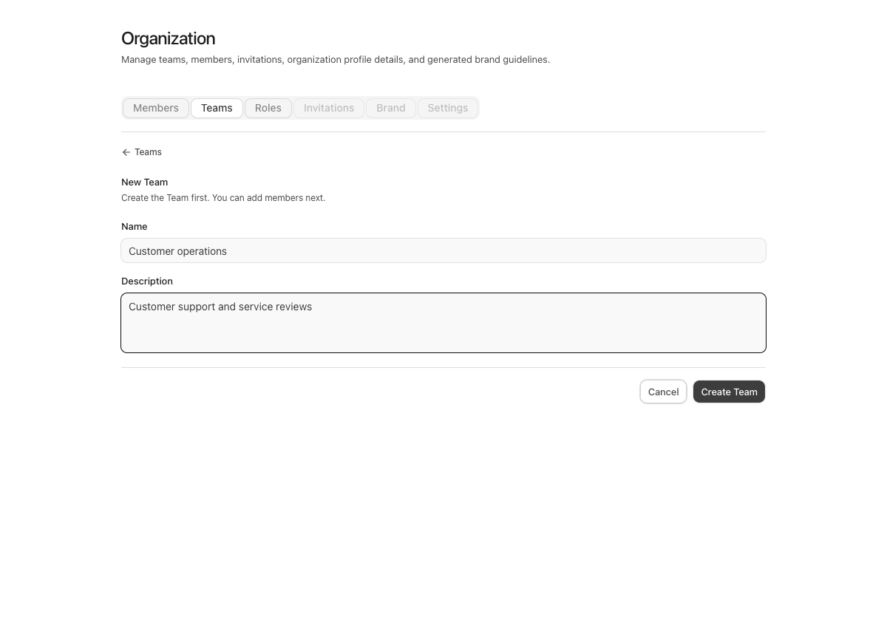
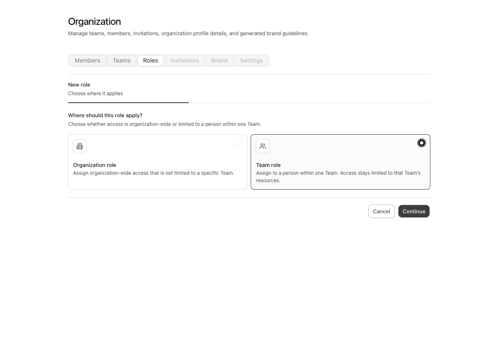
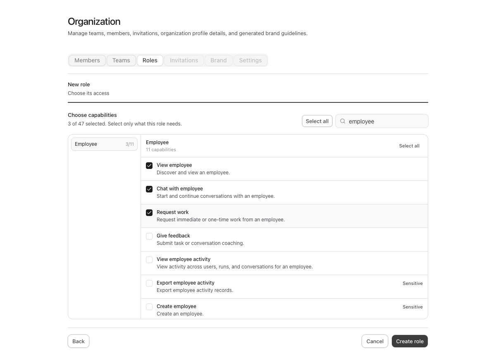
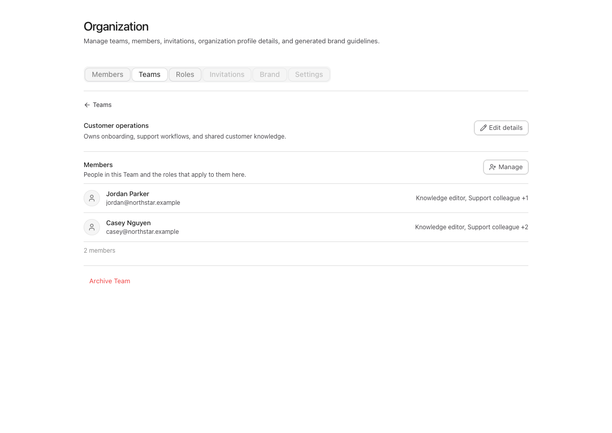
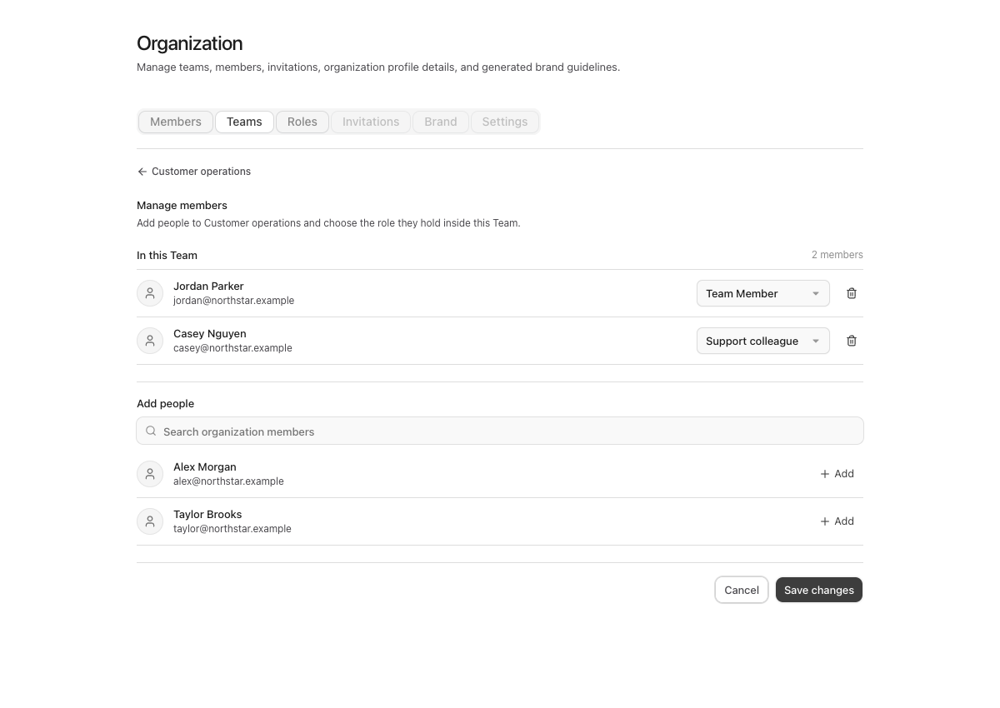
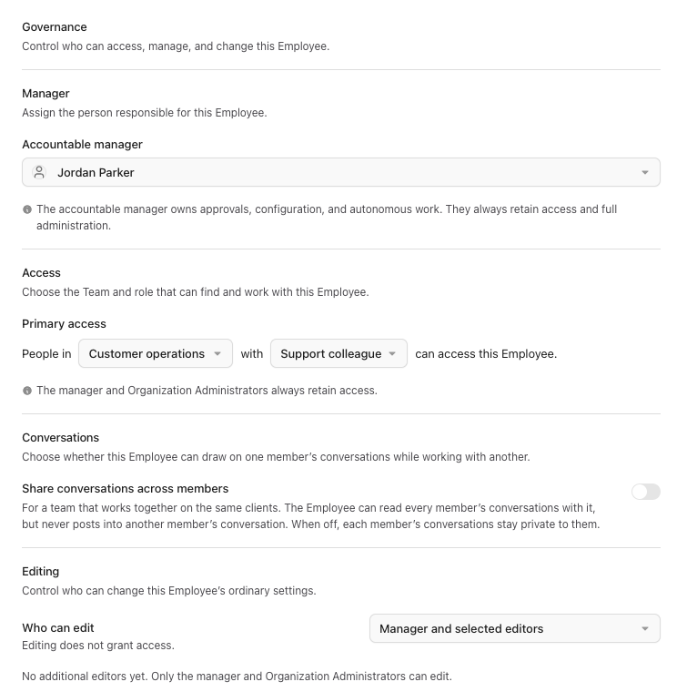

Build a Customer operations worker that selected colleagues can use without giving them permission to change its security settings.

**Outcome:** colleagues with the **Support colleague** role inside **Customer operations** can view, chat with, and request work from the worker. Its manager controls configuration. Connected writes require review during the pilot.

<Warning>
  The manager and people with broad employee-administration access retain
  applicable access. This tutorial restricts ordinary colleagues; it does not
  create a boundary against your organization's authorized administrators.
</Warning>

## Before you start

Use an organization account and non-sensitive test data. You need permission to manage teams and roles, assign the worker's manager, and manage its access. If a control is read-only, ask the person with that specific permission to complete the step.

Have an AI Employee available and choose three test members: an intended user, a teammate without the required role, and someone outside the team. None should be the worker's manager or a broad employee administrator.

<Steps>
  <Step title="Create the team">
    Open **Account → Organization → Teams → New Team**. Enter **Customer operations** and a description such as “Customer support and service reviews.” Select **Create Team**.

    <Frame caption="Creating a team with synthetic Storybook example data.">
      
    </Frame>

    Creating the team does not place every worker in it. You will choose this team on the worker's Governance panel later.

  </Step>
  <Step title="Create a narrowly scoped permission role">
    Open **Account → Organization → Roles → New role**.

    1. Choose **Team role**, not Organization role, then **Continue**.
    2. Name it **Support colleague**. Describe when it should be assigned, then continue.
    3. In **Choose capabilities**, open the **Employee** category.
    4. Select **View employee**, **Chat with employee**, and **Request work**.
    5. Leave unrelated capabilities unselected and choose **Create role**.

    <Frame caption="Choose Team role to keep the assignment scoped to a team. Synthetic example data.">
      
    </Frame>

    <Frame caption="Select the three capabilities needed for this example. Synthetic example data.">
      
    </Frame>

    Do not use **Select all** for convenience. Activity viewing, exports, manager assignment, and access management are separate responsibilities. Worker configuration editing is controlled on the individual worker's Governance panel.

  </Step>
  <Step title="Add members and assign their team roles">
    Return to **Teams**, open **Customer operations**, and select **Manage** in the members section.

    Add the intended user and the teammate you will use for the negative test. Choose **Support colleague** as the intended user's role inside this team. Give the other teammate an appropriate different role that does not satisfy the worker's required-role rule. Save the membership changes.

    <Frame caption="Open Customer operations to manage its people. The local synthetic fixture uses the Support colleague role from this tutorial.">
      
    </Frame>

    <Frame caption="Choose Support colleague for Casey inside Customer operations, then save the membership changes. Synthetic example data.">
      
    </Frame>

    Assigning a team role to someone in another team is not the same as assigning it inside Customer operations.

  </Step>
  <Step title="Restrict the worker's audience">
    Open your AI Employee's **Settings → Governance**.

    - Choose the **accountable manager** who should own configuration and approvals.
    - Under **Access**, choose **Customer operations** rather than everyone in the organization.
    - In the role selector, choose **Support colleague** rather than **Any compatible role**.
    - Leave **Share conversations across members** off for this pilot.

    <Frame caption="The synthetic tutorial fixture shows Customer operations with Support colleague, private conversation context, and no additional editors.">
      
    </Frame>

    If Support colleague is missing, confirm that it is a **Team role** and contains **View employee**. A permission role belongs to people; selecting it here makes that role a requirement for the audience.

  </Step>
  <Step title="Limit who can change the worker">
    Under **Who can edit**, choose **Manager and selected editors** and remove any additional editors for the pilot. With no selected editors, only the manager and authorized organization administrators can edit. If a colleague needs to maintain instructions, add only that person or the appropriate team-role combination.

    Grant **Working instructions** only if that is their responsibility. Do not also grant **Sending & approvals**, **Skills, tools & intelligence**, or **Who can contact the Employee** unless needed.

    Select **Save Changes** and reload the panel to confirm the saved manager, team, role requirement, sharing choice, and editing policy. Selecting an editor does not grant worker access.

  </Step>
  <Step title="Set conservative connected-tool and messaging policies">
    Open **Security & Privacy**:

    - Set **Inbound Access Policy** to **Organization members** for the pilot. This is a channel rule, not a replacement for the worker's internal team audience.
    - Set **Tool approval policy** to **Approval-first** while testing.
    - Set **Outbound Messaging Policy** to **Ask every time**, or **Disabled** if no outbound messaging is needed.
    - Review and remove saved allow exceptions that would undermine the pilot's review policy.

    Assign only the knowledge, workflows, and tools needed for customer support. Connect a test provider account with narrow provider-side permissions. Do not put passwords or API keys into chat or instructions; use supported connections and [Vault](/platform/vault).

    Connected-tool approval settings are not a universal browser-action approval policy. Review [Tool and browser boundaries](/platform/tool-and-browser-security) before enabling signed-in website work.

  </Step>
</Steps>

## Verify allowed and denied behavior

Use separate member sessions. Do not verify everything while signed in as an administrator.

| Test                                                                                            | Expected result                                                                                |
| ----------------------------------------------------------------------------------------------- | ---------------------------------------------------------------------------------------------- |
| Intended user in Customer operations with Support colleague                                     | Can view, chat with, and request work from this worker.                                        |
| Customer operations teammate without the required role                                          | Cannot gain access through the primary audience rule.                                          |
| Member outside Customer operations                                                              | Cannot gain access through this team rule, even if assigned the same role in a different team. |
| Ordinary intended user tries to change security settings                                        | Cannot edit those settings under the manager-only policy.                                      |
| Selected instructions editor, if configured                                                     | Can edit permitted instructions, but cannot edit ungranted settings areas.                     |
| Worker attempts an ordinary connected-tool read under Approval-first, without a saved exception | Requires approval.                                                                             |
| Worker attempts an ordinary connected-tool write, without a saved exception                     | Requires approval before proceeding.                                                           |
| Worker attempts an outbound message under Disabled                                              | Outbound messaging is blocked.                                                                 |

For denial tests, also try a previously copied worker link; absence from a list is not sufficient evidence. Review other roles and explicit access grants if an unexpected user still qualifies. Confirm the saved tool policy, exceptions, and action type if an action proceeds without the expected review.

Review the worker's [Activity Log](/workforce/activity) and [Approvals](/workforce/approvals) alongside these tests. A rejected attempt may not create the same activity record as completed work; do not assume the Activity Log is a complete security audit export.

## Move from pilot to production

- Record the manager, intended audience, editor areas, approved connections, and any saved exceptions.
- Re-run the tests after changing roles, team membership, worker governance, or tool policies.
- If you later choose Recommended tool approvals, test the exact operations you intend to allow; drafts and some low-risk actions can be treated differently from ordinary writes.
- Review membership and exceptions periodically. Removing a team assignment does not remove an unrelated organization-level grant.
- During handovers, reassign the manager and review unattended work and credential scope. See [Manager responsibilities](/workforce/manager-responsibilities).

For a deeper explanation, see [How access control works](/platform/access-control). Continue with [Read-only Finance worker](/platform/finance-read-only-tutorial) for a blocked-write example, [Manager handover](/platform/manager-handover-tutorial) for transfers and offboarding, or [Security review checklist](/platform/security-review) to record your evidence.
