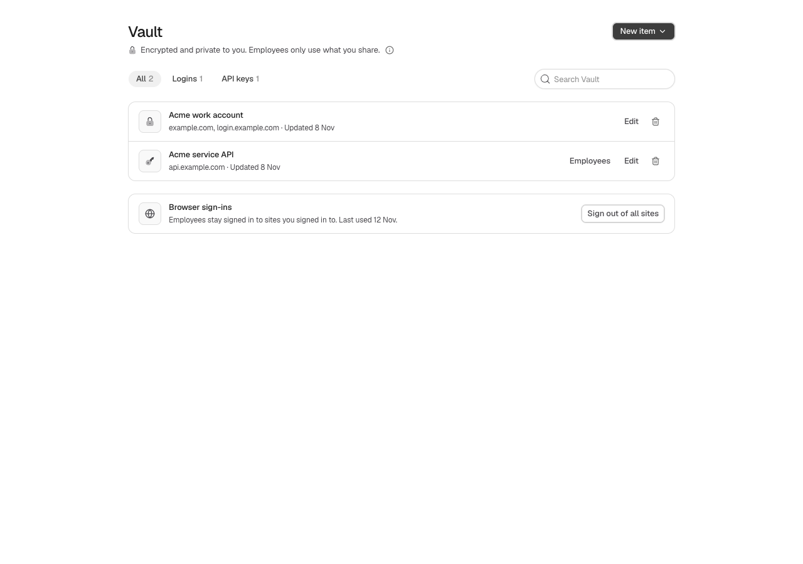

Open **Account → Vault** when available for your account. Vault stores credentials; it is not a [Document Store](/documents/overview), an integration catalog, or a place to upload signing records.

<Note>
  Availability and permission to view/manage Vault are checked separately. If Vault is missing or unavailable, ask your administrator or support. Do not put credentials into a chat as a workaround.
</Note>

<Frame caption="Vault with example items and browser sign-ins. Synthetic Storybook example; no real credential is displayed.">
  
</Frame>

## Save a login or key

1. Select **New item → Login** or **API key**.
2. Enter a recognizable name. For a login, enter the username and password and the exact HTTPS website. Website entries use origins, without paths or query parameters.
3. For an API key, enter the key or named secret fields supported by the form. Add the intended service website when needed.
4. Add a usage hint if useful, without duplicating the secret in the name, website, or hint.
5. Save and confirm that the item appears. Use search or **Logins / API keys** to find it later.

Saved passwords and API-key values are not returned for display or copying. Visibility controls show newly entered values, not stored secrets. To rotate one, select **Edit**, enter a replacement, and save. Leaving a replacement omitted preserves the existing value; do not enter an empty value to clear it.

## Decide what employees may use

Saving an item does not share it automatically.

- **Login requests:** When an employee requests a browser login, review the destination and choose the appropriate login through the credential request UI. Do not send its password in the conversation. Complete interactive sign-in yourself when required; see [Computer and browser handoff](/workforce/computer).
- **API keys:** Where the **Employees** control is offered, open it on the key. Set exactly one service website before sharing. Choose how the service expects the key—Bearer, a named header, or a named query parameter—and explicitly grant only the intended employees the offered access level.
- Employee code calls the service through Odella, which adds the key; the key itself does not reach the employee. In chat it uses the asking person's key; background work uses its manager's. Check that the correct owner has configured access.

Review grants after employee or manager changes. Sharing a key does not override the provider's permissions or authorize arbitrary business operations. Use a provider-issued key with the narrowest access possible.

## Browser sign-ins

When **Browser sign-ins** is shown, it describes sites retained for your employees' browser between restarts. Select **Sign out of all sites** and confirm to clear those saved sign-ins. You will need to sign in again when an employee asks.

Clearing browser sign-ins is separate from deleting a Vault item or revoking a provider credential. Do not assume one performs the others.

## Delete or revoke

Use the item's delete control and confirm to remove it from Vault. This does **not** revoke the password or key at its provider. If a credential was exposed, revoke or rotate it at the provider too, replace any dependent connection, and review employee grants.

Vault is private to your user within the current account and region. Switching accounts does not move entries. Metadata such as names and website origins is not a suitable place for secrets. Storage encryption is server-managed, not a promise of zero-knowledge storage.

## Troubleshooting

- **No management controls:** You may have view access without manage access.
- **No matching items:** Clear search and category filters and confirm the current account.
- **Cannot share a key:** Set exactly one HTTPS service website and check the supported authentication format.
- **An edit conflicts:** Reload the current item and reapply the intended change; do not overwrite newer settings blindly.
- **Provider rejects the credential:** Check expiry, provider permissions, destination, and authentication format. Saving an item does not test it against the service.

Use [custom integration authentication](/integrations/custom-integrations#authentication-options) for an MCP integration's own credentials. A Vault item does not automatically create or reconnect an integration.
