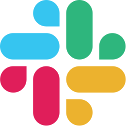
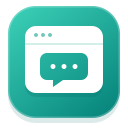
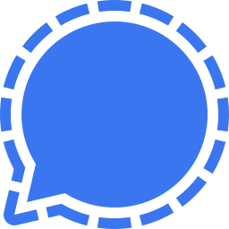

  <a className="channel-logo-card" data-channel="slack" href="/workforce/channels/slack">
    
      
      Slack
      →
    
    Create the workspace app, add credentials securely, and approve its installation.
  </a>
  <a className="channel-logo-card" data-channel="teams" href="/workforce/channels/teams">
    
      
      Microsoft Teams
      →
    
    Register the Microsoft app, configure the bot, and install the Teams package with administrator help.
  </a>
  <a className="channel-logo-card" data-channel="email" href="/workforce/channels/email">
    
      
      Employee email
      →
    
    Use the employee’s generated Odella address. Incoming email is restricted to authorized members.
  </a>
  <a className="channel-logo-card" data-channel="web-chat" href="/workforce/channels/web-chat">
    
      
      Web chat
      →
    
    Configure the employee’s existing Odella conversation and optional spoken replies.
  </a>
  <a className="channel-logo-card" data-channel="whatsapp" href="/workforce/channels/whatsapp">
    
      
      WhatsApp
      →
    
    Review organization eligibility, an assigned number, and manual/provider onboarding. Not fully self-service.
  </a>
  <a className="channel-logo-card" data-channel="phone" href="/workforce/channels/phone">
    
      
      Phone and SMS
      →
    
    Assign an active, capable number and verify eligibility, compliance, routing, and calling terms.
  </a>
  <a className="channel-logo-card" data-channel="telegram" href="/workforce/channels/telegram">
    
      
      Telegram
      →
    
    Create the bot with the official BotFather, save its token securely, and test a message.
  </a>
  <a className="channel-logo-card" data-channel="discord" href="/workforce/channels/discord">
    
      
      Discord
      →
    
    Configure a developer application, bot token, gateway intents, and server installation.
  </a>
  <a className="channel-logo-card" data-channel="signal" href="/workforce/channels/signal">
    
      
      Signal
      →
    
    Use a supported assigned number, complete SMS verification, and resolve a CAPTCHA when needed.
  </a>
  <a className="channel-logo-card" data-channel="google-meet" href="/workforce/channels/google-meet">
    
      
      Google Meet
      →
    
    Confirm availability and Google authorization with support. A saved meeting link is not proof of access.
  </a>

