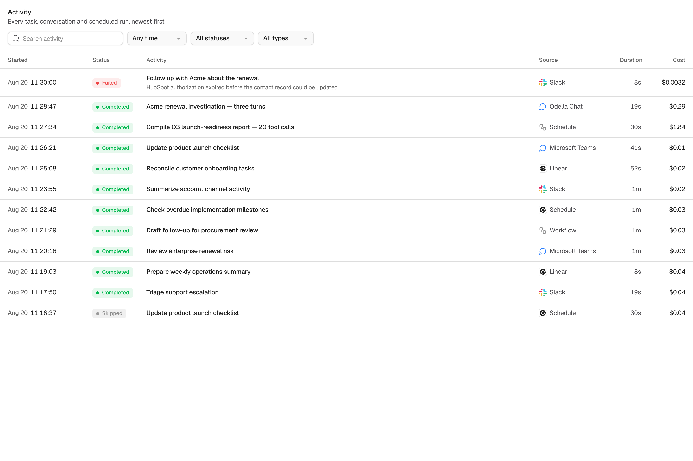

**Activity Log** is a live feed of what a worker has been doing. Use it to audit work, troubleshoot issues, and confirm that scheduled or event-driven tasks ran as expected.

<Frame caption="The actual Activity feed with synthetic tasks, conversations, statuses, sources, and usage figures. Figures are illustrative, not a billing quote or a complete security log.">
  
</Frame>

To investigate a run, search for its task or subject, narrow the time and status filters, then open the recorded entry where details are offered. Compare its reason and returned outputs with the task and destination system before retrying.

## Activity filters

| Filter         | Shows                                               |
| -------------- | --------------------------------------------------- |
| **All**        | Every recorded activity type.                       |
| **Threads**    | Conversations and message threads.                  |
| **Workflows**  | Workflow runs.                                      |
| **Heartbeats** | Service-status checks recorded by the platform.     |
| **Tasks**      | Scheduled tasks and event-triggered tasks.          |
| **Subagents**  | Work delegated to supporting workers during a task. |

## What to look for

Use Activity to answer questions like:

- Did the worker receive a message?
- Did a scheduled task run?
- Did an event action trigger?
- Which workflow did the worker use?
- Is the worker running normally?
- Did the worker delegate work to a subagent?

## Security reviews and record coverage

Activity is a worker-level work history, not a complete security audit export. Do not assume every denied access attempt, browser action, or network request appears here, or that a missing item proves an external action never happened.

Viewing activity across members and exporting activity are separate permissions. Confirm the records and export controls available to your account before using them as audit evidence. For retention, platform security logs, or assurance evidence beyond this view, coordinate a security review with Odella rather than assuming the Activity Log covers those requirements.

Use the [Security review checklist](/platform/security-review) to combine configuration reviews, ordinary-member access tests, approvals, and provider records.

## Troubleshooting with Activity

If a worker did not behave as expected:

1. Filter to the relevant activity type.
2. Check whether the event, task, or conversation was recorded.
3. Confirm the worker was active at the time.
4. Review connected skills, applications, and tool approval settings.
5. Check Calendar or Actions if the work should have started automatically.

<Tip>
  Activity is especially useful after changing schedules, actions, inboxes, or
  security settings. It gives you a quick way to confirm the worker is operating
  as intended.
</Tip>
