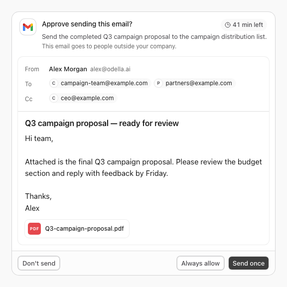
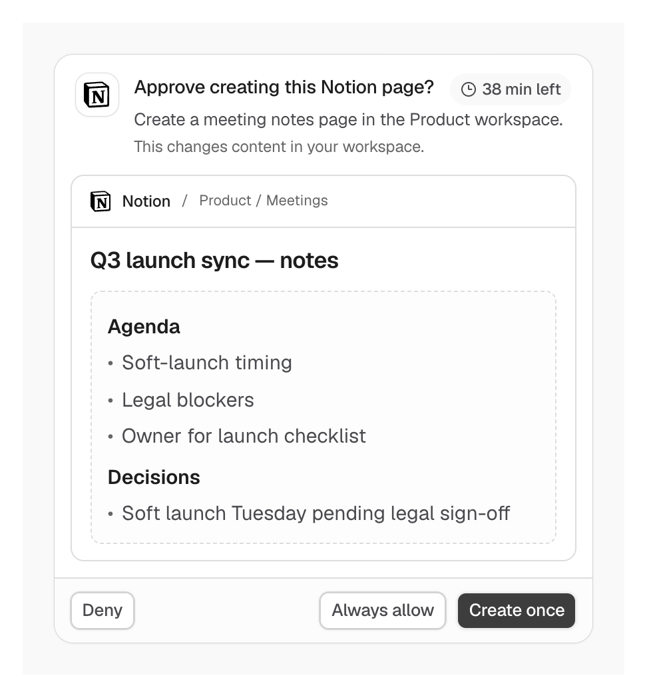

Approvals let a person review a proposed action before an AI Employee proceeds. The worker's [Security & Privacy policy](/workforce/settings-security-privacy), the action type, and account rules determine when review is required.

Requests can appear in chat, task details, or an approval link delivered through a supported channel. Treat approval links as private.

<Note>
  Connected-tool approvals are not a universal approval policy for browser
  clicks or every action a worker can perform. Review [Tool and browser
  boundaries](/platform/tool-and-browser-security) before relying on a preset
  for a sensitive workflow.
</Note>

## Review an approval

<Steps>
  <Step title="Open the current request">
    Follow the approval card or link. Confirm the worker and task are the ones
    you expect. Read the remaining time or status, if shown.
  </Step>
  <Step title="Inspect the action">
    Check the affected application, recipients, data, files, and proposed
    changes. For messages, inspect To, Cc, Bcc, body, and attachments. For
    destructive operations, confirm exactly what will be removed.
  </Step>
  <Step title="Choose the available decision">
    Approve this action once, deny it, or save an eligible exception only when
    you intend to permit future matching actions.
  </Step>
  <Step title="Check the result">
    Return to the task or conversation. Approval authorizes the action; it does
    not guarantee the external service will complete it successfully.
  </Step>
</Steps>

<Frame caption="An email approval with sample recipients and an attachment, rendered from Storybook.">
  
</Frame>

## Choose once, always, or deny

| Decision                     | Use it when                                                                                                          |
| ---------------------------- | -------------------------------------------------------------------------------------------------------------------- |
| **Approve once / Send once** | This specific proposed action is correct. Future actions still follow policy.                                        |
| **Always allow**             | You deliberately want to save the offered exception for future eligible actions. Review its scope before confirming. |
| **Deny / Don't send**        | The action should not proceed. Give corrected instructions separately if needed.                                     |

Button wording varies with the action. **Always allow is not available for every request** and may require signing in to review the saved rule. Signing invitations require one-time review rather than a reusable signing-send exception.

<Warning>
  Do not approve unfamiliar recipients, unexpected attachments, or a changed
  document based only on the worker's summary. Inspect the actual proposal.
</Warning>

### Connected-tool requests

For a connected-tool action, inspect the target service and proposed change as well as the worker's explanation. Check the specific destination or record before making a decision. Do not infer a general browser approval guarantee from this screen.

<Frame caption="A real connected-tool approval component with a synthetic Notion action. This is not a live request, and no decision is submitted.">
  
</Frame>

## Approvals in each channel

The decision concerns the proposed action, not the whole conversation. Controls depend on the channel, request type, and decisions you are allowed to make.

| Where the request arrives | How to respond |
| --- | --- |
| **Odella chat** | Open the approval card, inspect the proposal, and use its decision buttons. |
| **Signal** | React to the approval message with **👍 to approve once** or **👎 to deny**, when offered. Use its signed-in review link for fuller details or future-permission changes. |
| **Slack, Microsoft Teams, Telegram, Discord** | Use the approval card's buttons or its review link. Only the decisions offered for that request apply. |
| **WhatsApp** | Use **Approve once** or **Deny** when interactive buttons are offered, or open the review link. Emoji reactions are not an approval control here. |
| **Email** | Follow the request's decision or review links. Browser handoffs and Vault requests open signed-in Odella rather than being completed in an email reply. |
| **SMS** | Open the review link and inspect the request on the review page. Do not approve by sending a text reply. |

### Signal reactions

1. Find the current **approval message**, not the original assignment or a normal progress update.
2. Read the proposed action and open **Review (sign in)** if the message does not show enough detail.
3. Add **👍** to that message to approve **once**, or **👎** to deny, only when the prompt offers that decision. Skin-tone variants are supported.
4. Check the outcome and subsequent work. If it remains pending, use the signed-in review page rather than repeatedly reacting or creating duplicate work.

Your Signal identity must be linked to an authorized Odella approver. Being in the group, knowing the worker's number, or being able to message it does not grant approval authority. Expired or resolved requests cannot be made current again by reacting.

A thumbs-up sent as a new message is not the approval reaction. A worker's thumbs-up status reaction is not your approval either. Signal reactions never mean **Always allow**; review future permissions separately in signed-in Odella.

<Warning>
  Treat approval links as private. Some email, WhatsApp, and SMS links can allow
  a one-time decision without signing in. Do not forward them or paste them
  into shared conversations. Signing, browser handoffs, Vault requests, and
  future-permission changes have additional signed-in review requirements.
</Warning>

### Requests that need you in Odella

For a **browser handoff**, sign in, open the browser, complete the necessary step, then choose **I'm done** or **Skip**. For a **Vault request**, use **Save in Vault** or **I don't have it** where offered. A plain approval or a secret sent in chat is not a substitute for completing those steps. See [Computer and browser handoff](/workforce/computer) and [Vault](/platform/vault).

## Saved exceptions

Saved recipient and tool rules appear in the worker's **Security & Privacy** settings. An authorized person can remove an exception to return future actions to the default policy. A saved rule is not a grant of access to an application or resource the worker cannot otherwise use.

Prefer one-time approval while testing a new process. Save narrow exceptions only after confirming the repeated action is appropriate.

## When a request cannot be approved

- **Expired or already resolved:** Return to the task and check its current state. Use a fresh request rather than an old link.
- **Document changed:** Review the latest version and its recipients. Earlier approval does not authorize a different signing draft.
- **Preview is loading or unavailable:** Wait or retry. Some actions remain unavailable for approval until their review material is ready; denial can still be offered.
- **Permission denied:** Sign in with the intended account and ask the appropriate manager to review access.
- **Approved, but task still failed:** Inspect the execution error. Provider permissions, invalid data, or insufficient credit can still prevent completion.

For signing-specific review, see [E-signing](/templates/05_e-signing). For a task waiting on your decision, see [Tasks](/workforce/tasks).
