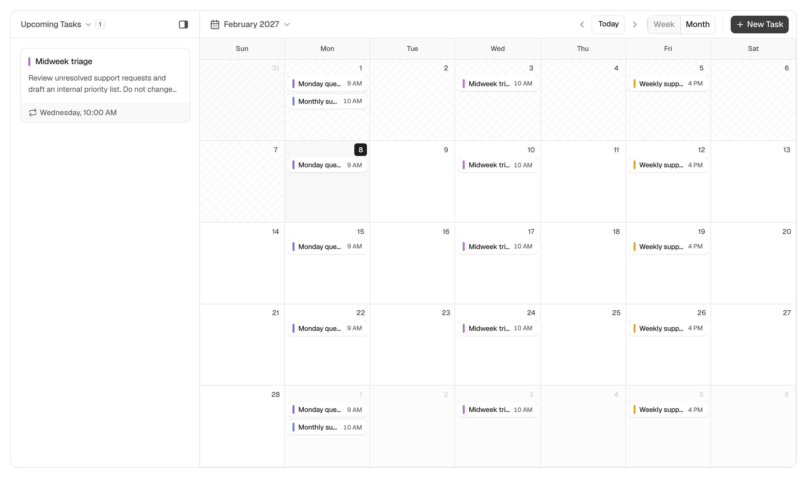
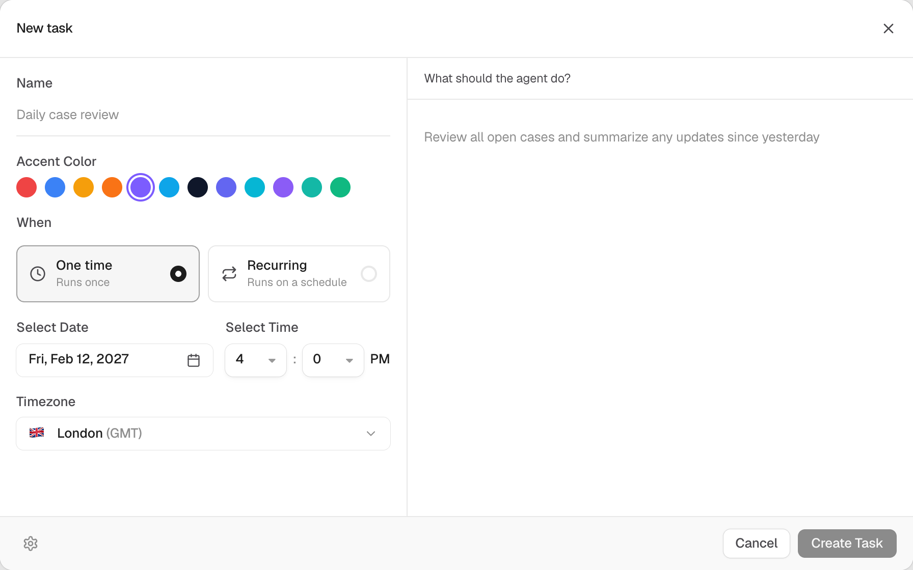
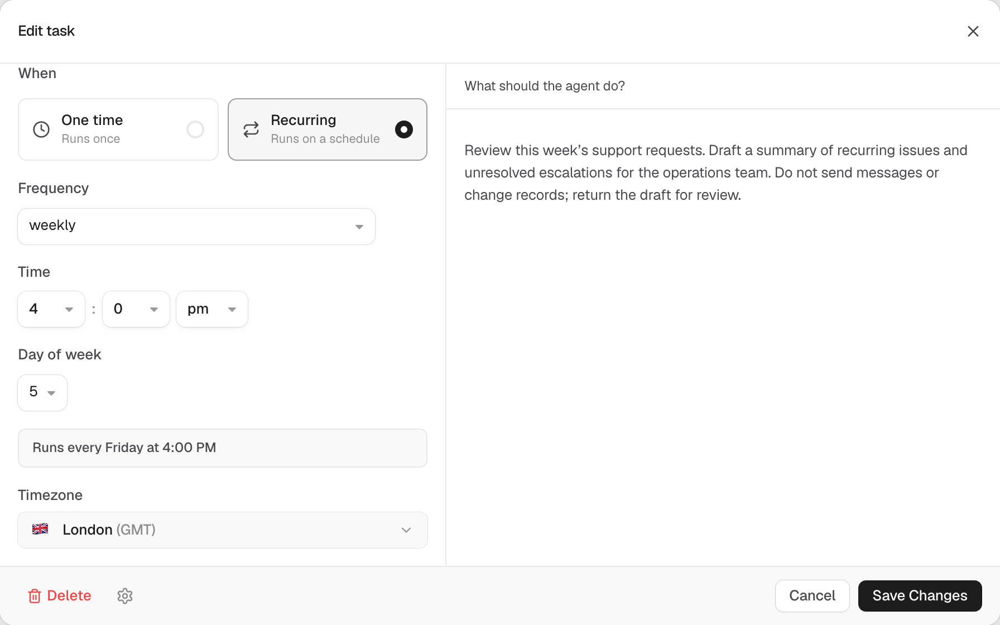

Use **Calendar** to schedule work for a worker. Calendar manages time-based [Actions](/workforce/actions); each execution can create work tracked in [Tasks](/workforce/tasks). Use it for recurring reports, daily checks, weekly summaries, and reminders.

<Frame caption="Calendar with fictional queue reviews and a weekly support summary. Actual product components with synthetic records, not a live employee's schedule.">
  
</Frame>

## Creating a scheduled task

<Steps>
  <Step title="Open the employee's Calendar">
    Open the AI Employee and select **Calendar**. Select **New Task**, or choose a future calendar slot.
  </Step>
  <Step title="Name the work and describe the result">
    Use a clear name such as **Weekly support summary**. In the instructions, specify the inputs, expected output, where the draft should go, and what the worker must not do.
  </Step>
  <Step title="Choose when it runs">
    Select **One time** for a single date, or **Recurring** for a repeating schedule. For the weekly example, choose a weekly frequency, **Friday**, and **4:00 PM**. Read the schedule summary beneath the controls to confirm the day and time, then check the timezone explicitly; the example uses **London**.
  </Step>
  <Step title="Review and create">
    Check the instructions, cadence, time, and timezone, then select **Create Task**. When editing an existing schedule, use **Save Changes** instead. Confirm the saved entry appears in Calendar.
  </Step>
  <Step title="Check the first result">
    Inspect the resulting task and Activity after a controlled run. A visible calendar entry confirms configuration, not that the work has completed successfully.
  </Step>
</Steps>

<Frame caption="The new-task dialog: name, instructions, One time or Recurring, and timezone. Synthetic Storybook example; no task is submitted.">
  
</Frame>

<Frame caption="A filled recurring editor for Weekly support summary, set to Friday at 4 PM in London. Synthetic example; screenshot shows editing, not a successfully executed task.">
  
</Frame>

A scheduled task includes:

| Setting                | What it does                                                                       |
| ---------------------- | ---------------------------------------------------------------------------------- |
| **Name**               | A short label for the scheduled task.                                              |
| **Task instructions**  | The prompt the worker receives when the task runs. Explain the outcome you expect. |
| **Schedule type**      | Choose a one-time task or a recurring task.                                        |
| **Date and time**      | When a one-time task should run. Past dates cannot be scheduled.                   |
| **Recurring schedule** | A repeating cadence for recurring work.                                            |
| **Timezone**           | The timezone used to interpret the scheduled time.                                 |
| **Active state**       | Check the schedule's Action controls. Disabled definitions are saved but do not start new work; this is not a checkbox in the new-task form above. |

## Managing scheduled work

You can:

- Edit an existing task.
- Drag a task to reschedule it.
- Delete a task.
- Use the schedule's [Action controls](/workforce/actions) to disable future automatic starts without deleting the definition.
- For recurring tasks, choose whether changes apply to the whole series or only one occurrence.

<Tip>
  Write task instructions like a delegation note to a colleague. Include
  context, the expected output, where to find inputs, and where the result
  should go.
</Tip>

## Test and follow a scheduled run

Check the timezone on the schedule itself, especially around daylight-saving changes. Confirm the worker is active and its working-hours policy permits the requested work. Use **Run now** where offered for a controlled test, then inspect the resulting task and Activity.

A schedule is the recurring definition; a task is an individual execution. Disabling or deleting the schedule does not undo actions from past runs. Check existing tasks before manually repeating a missed or interrupted run.

## Example task instructions

```text
Every Friday at 4pm, review this week's inbound support emails. Summarize the top recurring issues, list any unresolved customer escalations, and draft a short update for the operations team.
```

<Warning>
  Scheduled tasks run automatically when enabled. Make sure the worker has the
  right knowledge, tools, and approval policy before scheduling sensitive work.
</Warning>
