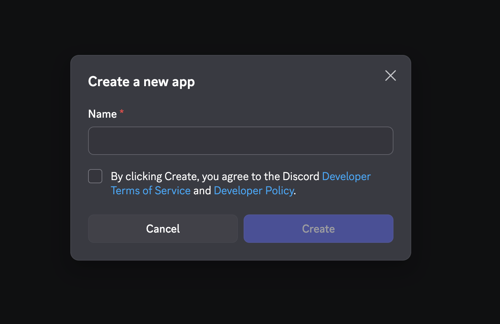
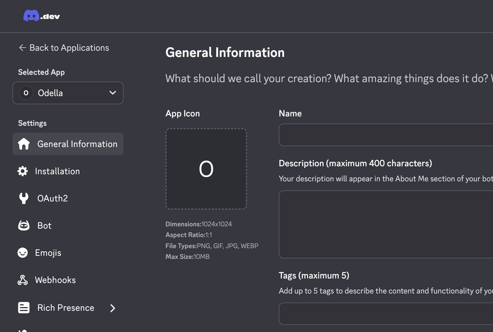
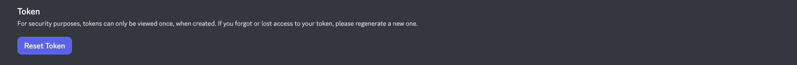
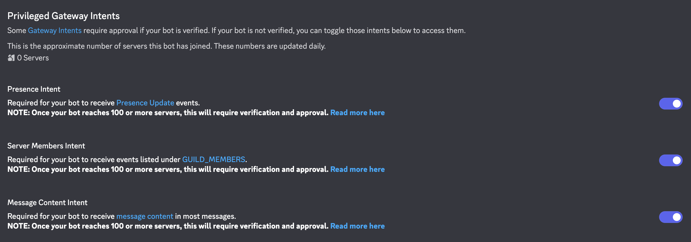

## Before you start

You need permission to manage the employee's channels, a Discord developer account, and **Manage Server** permission in the intended server (or help from its administrator). Keep the bot token private.

The screenshots below are existing provider-console illustrations. Application IDs are derived during activation; do not copy another bot's identity.

## 1. Create the application

Open the [Discord Developer Portal](https://discord.com/developers/applications), select **New Application**, and choose a recognizable employee name.

<Frame caption="Create your own Discord application.">
  
</Frame>

Open **Bot** in the application's navigation and review the bot's name/avatar. Odella attempts to synchronize the employee's description/icon during setup; verify the result rather than assuming a profile change proves delivery.

<Frame caption="The application sidebar includes the Bot settings section.">
  
</Frame>

## 2. Obtain the bot token

On **Bot**, use **Reset Token** as directed and copy the newly displayed token into Odella's **Discord Bot Token** secret field. Creating/resetting a token can invalidate a previous connection; coordinate rotation if this bot is already in use.

<Frame caption="Token controls only; no token value is shown.">
  
</Frame>

## 3. Review gateway intents

In **Privileged Gateway Intents**, follow the current Odella setup guide:

- **Message Content Intent:** required by the guide for reading message content.
- **Server Members Intent:** recommended for member lookups and role-related features.
- **Presence Intent:** optional; only enable if you need presence updates.

Review Discord's approval requirements with your administrator, then save changes. The historical illustration shows all toggles enabled; that is not an instruction to enable every optional permission.

<Frame caption="Gateway-intent locations. Select only the intents required for your use case.">
  
</Frame>

## 4. Create and install

1. Select **Create** in Odella once the token is entered.
2. Odella validates the bot and derives the Discord Application ID; it attempts to configure its profile/interactions and slash commands.
3. Complete the server installation window that opens. If it was blocked, use the generated **Add to Discord Server** link once available.
4. Choose the intended server and review permissions, including viewing channels, sending messages, reading history, embeds, attachments and reactions as requested by the installation.

A published Odella channel is not proof the bot was installed on a server. Server/channel overrides may still prevent reading or replying.

## 5. Test and recover

Send a low-risk request along an allowed direct-message or server-channel path. Verify the right employee replies and work appears in Activity.

- **Installation link missing:** finish identity validation; do not type a guessed Application ID.
- **No server choices:** use an account with Manage Server permission.
- **Bot installed but no reply:** check channel visibility, permissions, required intents, Odella publication, employee availability and admission policy.
- **Token rotated:** enter the replacement securely, re-establish the connection through the supported flow, and retest. Do not assume saving alone reinstalls or verifies the bot.

Keep access/security policy changes in the employee UI. Removal in Odella is not proof that Discord server installation or the developer application was deleted. Review those separately with the server/app owner.
