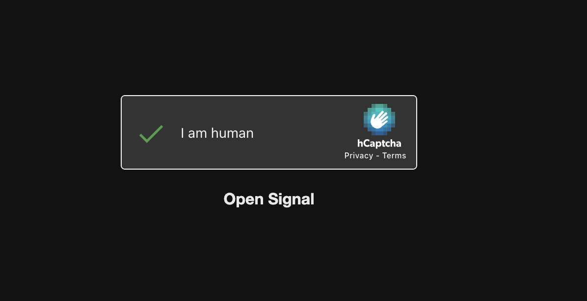

Signal uses the employee's assigned phone number. Registration, verification, publication and sharing the contact link are separate stages.

## Before you start

- Permission to manage the employee's channels and the account's number-registration steps.
- An **active number assigned to this employee** with working supported SMS delivery. Review [Phone setup](/workforce/channels/phone) if a number is not yet available.
- Current setup uses supported Telnyx number/SMS routing. A number from another provider is not automatically eligible for Signal verification.

Do not register a number already serving another Signal account without coordinating with its owner. Account registration changes can affect the existing installation.

## 1. Select the assigned number

Open the employee's **Channels → Signal** and select the assigned active number. The setup guide starts registration automatically where supported. You do not need to enter an infrastructure relay URL or webhook secret.

## 2. Complete verification

| Guide state                            | Next step                                                                                                                |
| -------------------------------------- | ------------------------------------------------------------------------------------------------------------------------ |
| Unregistered                           | Let initial verification start; use **Retry verification** if it did not start.                                          |
| Verification requested / `pending_otp` | Wait for the verification SMS. Odella receives and verifies it automatically; you do not normally enter a code yourself. |
| Active                                 | The number is verified and the Signal account connected; publication is still a separate step.                           |
| Rejected                               | Read the reason. A fresh CAPTCHA or a routing/support correction may be needed.                                          |

Use **Check status** to refresh. If SMS delivery takes longer than expected, use **Resend verification SMS** when offered. Avoid repeated rapid retries or creating duplicate channels; ask support to check routing if a resend does not arrive.

## 3. Complete a CAPTCHA if requested

Follow the challenge link shown in the setup guide and complete it yourself. On the resulting page, right-click **Open Signal** and copy the link address. Paste that fresh link only into the Signal setup form's challenge field and use its retry control.

<Frame caption="Existing Signal challenge illustration: copy the Open Signal link after completing the challenge.">
  
</Frame>

The link is short-lived verification material, not your employee's public contact link. If a fresh challenge is rejected, stop repeated retries and contact support. Do not put challenge links or verification codes into ordinary conversation history.

## 4. Choose a username and publish

Once active, set a Signal username if the guide offers it. The nickname accepts letters, digits and underscores, starts with a letter, and is 3–32 characters; Signal adds a numeric suffix. A username is not a verified safety number or proof that the sender is an account member.

Select **Publish Signal** only when the selected number is verified for this employee. Odella checks the assigned number again; a pending request cannot be published as ready.

## 5. Share and test the contact

After publication, use the displayed contact QR/link. A username link works when phone-number discovery is disabled; otherwise the guide may offer a phone-number link. Do not confuse the contact QR with a device-linking QR or a verification challenge.

With the participant's permission, send a low-risk direct message from an allowed contact. Verify the reply and Activity. Group/mention access is a separate security review in the employee UI.

## Troubleshooting and changes

- **Selected number not eligible:** confirm active assignment, supported provider and SMS routing before requesting more verification attempts.
- **Verified with Signal but not connected in Odella:** the final connection update may have failed; use the offered recovery/support flow before publication.
- **Publish disabled:** check active registration for the currently selected number, not another number in the account.
- **Contact link fails:** check whether phone discovery is disabled and use the current username link if available.
- **Published but no reply:** check employee availability, access policy, Signal connection health and Activity.

Review all channels sharing this number before reassignment or removal. Provider encryption does not mean employee processing is confined to the sender's device; follow your organization's privacy and information-sharing rules.
