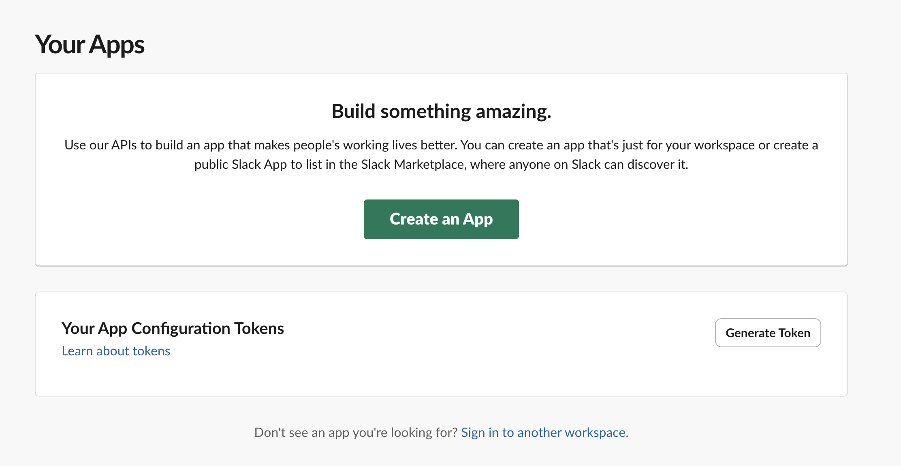
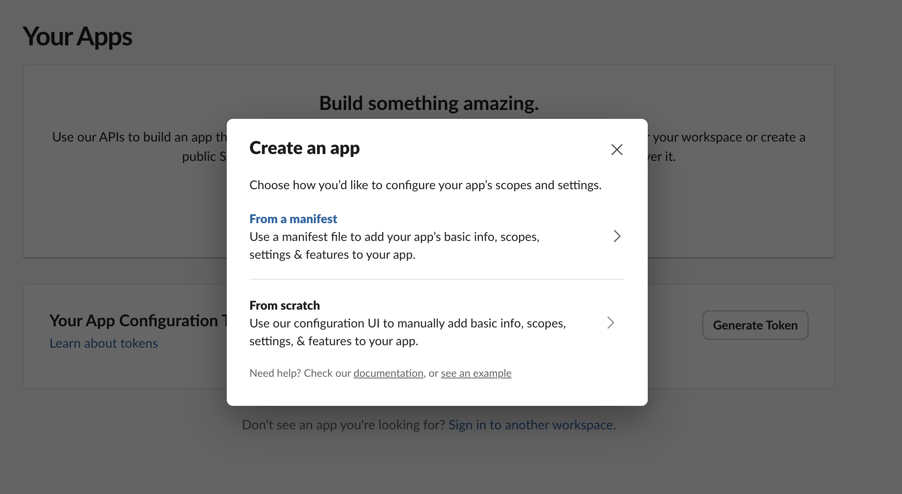
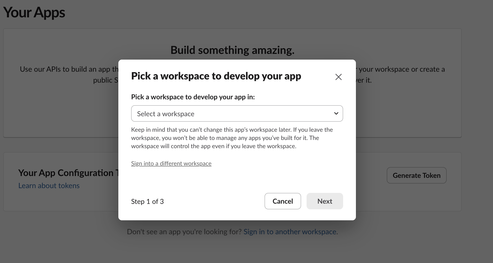
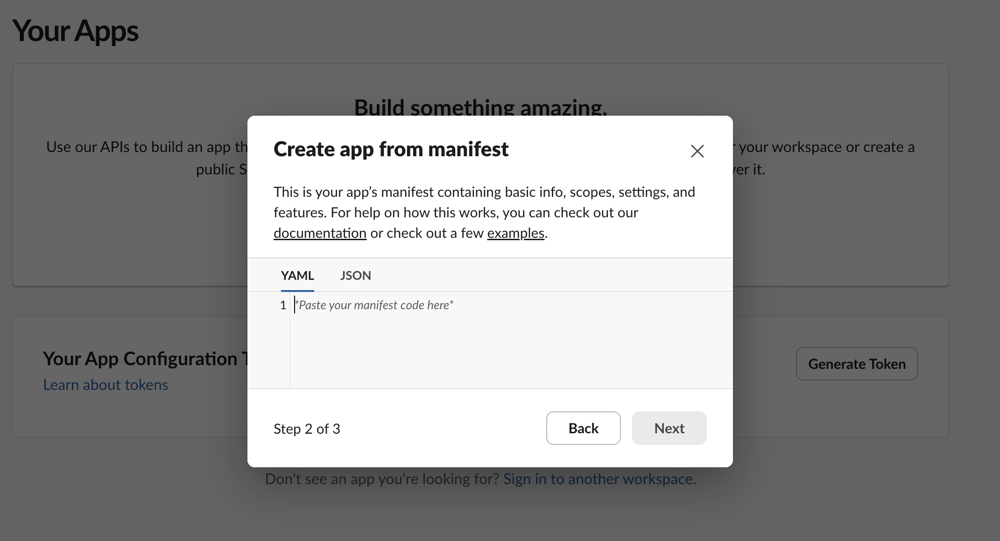
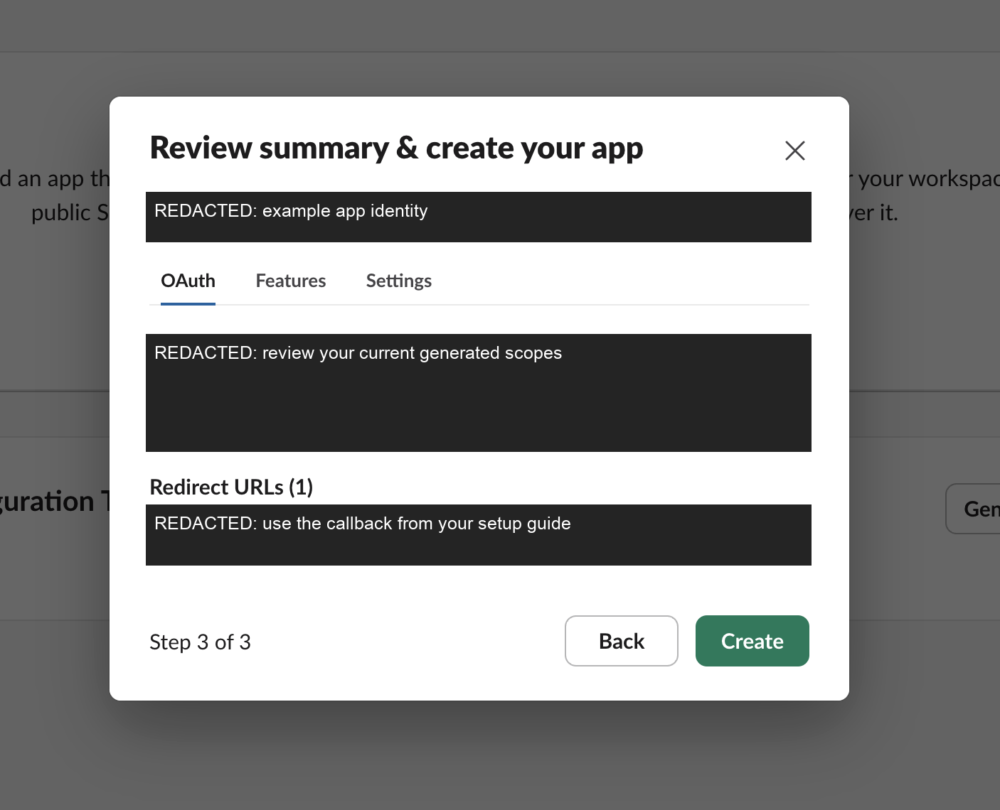
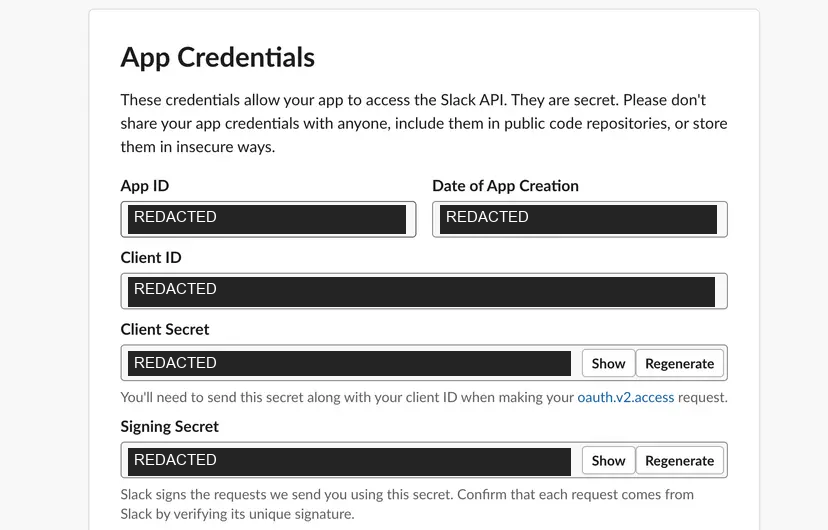

Slack setup has two distinct parts: creating the Slack app for this employee, then approving its installation in your workspace. A connected Slack toolkit is separate from this communication channel.

## Before you start

- Permission to manage the employee's channels in Odella.
- Permission to create/install apps in the intended Slack workspace, or help from its administrator.
- Keep the employee's Slack setup guide open: its generated manifest contains the correct callback, events, actions and command addresses.

<Note>
  These screenshots are reused setup illustrations, not a live account. Provider
  screens can change. Identifiers and credential values have been redacted.
  Always use your current generated manifest, not values or permission lists
  from an illustration.
</Note>

## Option A: assisted app creation

Where **Let us create the app for you** is offered, the assisted request also requires permission to manage account channels in Odella. If you can edit this employee but not manage account channels, ask the appropriate administrator or use the permitted manual setup path.

1. Open [Slack Apps](https://api.slack.com/apps) and find **Your App Configuration Tokens**.
2. Generate an access token for the correct workspace using an account authorized to do so.
3. Paste it only into the setup guide's password field and select **Create the app**.
4. Review the four credential fields filled by the guide. Continue to workspace authorization below.

This configuration token is powerful: it can manage workspace apps. The flow uses it for the creation request rather than saving it as a long-term channel credential. If your workspace does not permit generating one, use the manual path instead. Never paste it into a conversation.

## Option B: create the app manually

### 1. Open the app dashboard

Open [Slack Apps](https://api.slack.com/apps/new) and select **Create New App**.

<Frame caption="Existing Slack setup illustration: create an app.">
  
</Frame>

### 2. Choose a manifest and workspace

Select **From an app manifest**, choose the intended workspace, and continue.

<Frame caption="Choose the manifest-based setup.">
  
</Frame>
<Frame caption="Select the workspace that will host this employee.">
  
</Frame>

### 3. Paste the generated manifest

Select the **JSON** tab. Replace the sample content with the manifest copied from this employee's Odella setup guide. Review the requested permissions and addresses, then create the app.

<Frame caption="Use JSON and paste the manifest generated for your channel.">
  
</Frame>
<Frame caption="Review illustration with historical app identity, scopes and callback redacted; your current generated manifest is authoritative.">
  
</Frame>

### 4. Enter the four credentials

In Slack **Basic Information → App Credentials**, copy these into their matching Odella fields:

| Slack value    | Odella field             |
| -------------- | ------------------------ |
| App ID         | Slack App ID             |
| Client ID      | Slack Bot Client ID      |
| Client Secret  | Slack Bot Client Secret  |
| Signing Secret | Slack Bot Signing Secret |

<Frame caption="Credential locations only. All values are redacted; the deprecated Verification Token is not used.">
  
</Frame>

## Authorize the workspace

1. In Odella, select **Create** once all four fields are complete.
2. Review Slack's installation/consent screen for the intended workspace. Ask an administrator if approval is required.
3. Finish the return to Odella. Do not close the flow before it completes.
4. Open the installed app in Slack. Send a low-risk direct message from an allowed member and verify the reply and Odella Activity.
5. Before using a shared Slack channel, ensure the bot is invited/allowed there and review both Slack permissions and the employee's access policy.

App creation alone is not workspace installation. A published channel still depends on correct Slack permissions, callback configuration and employee availability.

## Troubleshooting and maintenance

- **Installation denied:** have a workspace administrator review app approval.
- **Invalid/expired authorization code:** restart the supported connection flow; codes are not reusable.
- **No inbound events:** compare generated event/actions/command URLs, signing-secret entry, installation and channel membership. A typo in the signing secret can prevent inbound verification even when app creation succeeded.
- **Missing member:** check workspace/account identity matching and the employee's access settings in the UI.
- **Credentials rotated:** update them through secret fields and complete any reconnection steps; retest inbound verification and outbound delivery rather than assuming a saved field proves recovery.

<Warning>
  Never put Client Secret, Signing Secret, bot tokens or app configuration
  tokens in prompts, screenshots or public repositories. If exposed, have an
  authorized owner rotate them. Changing access or security policy must be done
  in the employee UI.
</Warning>
