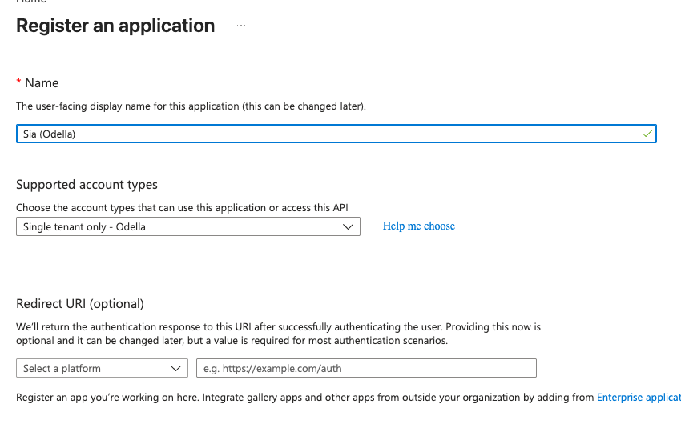
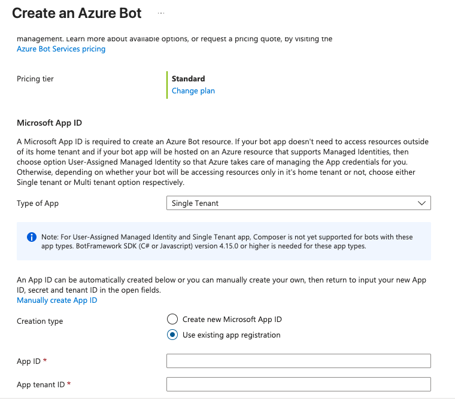
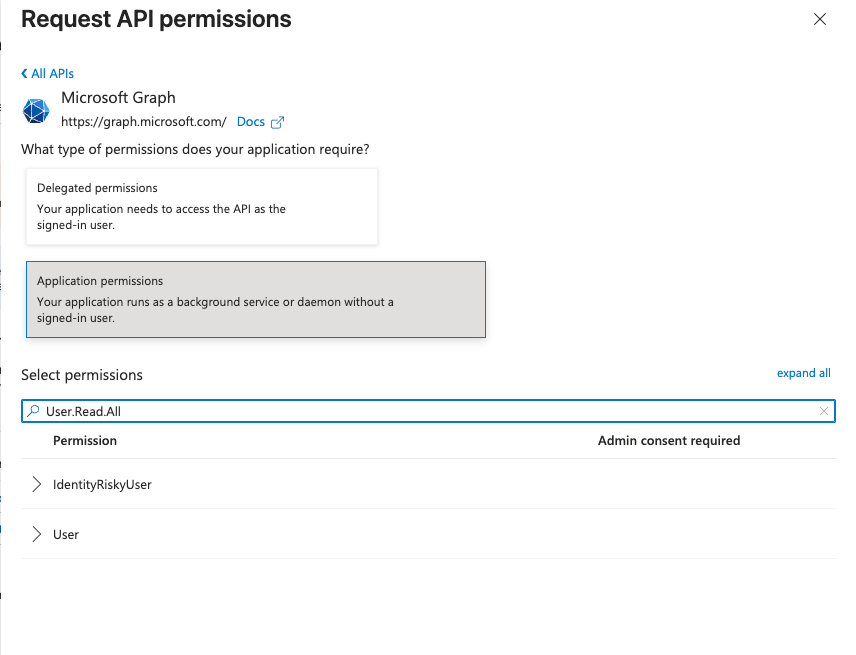

Microsoft Teams is a multi-stage setup. You may need different people for Microsoft Entra app registration, Azure resources, Graph admin consent and Teams app approval. Creating a channel in Odella does not create all those Microsoft resources for you.

## Before you start

- Permission to manage this employee's channels and an account eligible for paid channels. Review **Account → Limits** for current requirements.
- An administrator for the intended Microsoft tenant and an approved Azure subscription/resource group.
- Keep this employee's Odella setup guide open for the exact messaging endpoint and generated Teams app package.

The screenshots below are existing provider-console illustrations. Follow the current guide and your administrator's tenant policy rather than copying example names, resource choices or identifiers.

## 1. Register the Microsoft app

1. Open [Azure App registrations](https://portal.azure.com/#view/Microsoft_AAD_RegisteredApps/ApplicationsListBlade) and select **New registration**.
2. Use a recognizable employee name. Select **Accounts in this organizational directory only** (single tenant), then register.
3. Copy **Application (client) ID** and **Directory (tenant) ID** into the matching Odella fields.
4. Open **Certificates & secrets → Client secrets → New client secret**.
5. Copy the secret's **Value**, not its **Secret ID**, into Odella's **Client Secret** field. Record expiry using your organization's credential process.

<Frame caption="Example Microsoft app registration using a single tenant.">
  
</Frame>

## 2. Create the Azure Bot

Open [Create Azure Bot](https://portal.azure.com/#create/Microsoft.AzureBot). Use the guide's suggested handle and your approved subscription/resource group.

- **Type of App:** Single Tenant.
- **Creation type:** Use existing app registration.
- **App ID:** the Application (client) ID from step 1.
- **App tenant ID:** the Directory (tenant) ID from step 1.

The Odella guide suggests F0; the historical screenshot shows a different pricing label. Confirm the current plan and costs before creating resources. Ask the subscription owner for the minimum required permissions if resource creation is blocked.

<Frame caption="Azure Bot configuration illustration; follow the current guide for pricing and your own resource values.">
  
</Frame>

## 3. Set the messaging endpoint

1. In the Azure Bot, open **Settings → Configuration**.
2. Paste the **Messaging endpoint** from this exact employee/channel's Odella guide.
3. Select **Apply**.
4. Open **Channels → Microsoft Teams**, review the terms, and enable the Teams channel.

Do not guess a regional endpoint or reuse another employee's URL.

## 4. Allow member matching

In the app registration, open **API permissions → Add a permission → Microsoft Graph → Application permissions**. Add **User.Read.All** and ask an authorized administrator to grant consent.

<Frame caption="Select the Graph application permission requested by the setup guide.">
  
</Frame>

This is directory-read access for member matching. Review it with your administrator; it does not grant unrestricted access to employees or data in Odella.

## 5. Create the channel and install the package

1. Confirm client ID, tenant ID and client-secret **Value** in Odella, then complete **Create**.
2. Select **Download Teams app package** in the guide once the client ID is valid. Use the package for this employee.
3. In Teams admin center, open **Teams apps → Manage apps → Actions → Upload new app**, upload the ZIP, and allow it under your tenant policy.
4. In Teams, find the app under **Apps → Built for your org** and add it. If your tenant permits direct custom app uploads, use that supported path instead.

A generated ZIP, saved secret or published Odella record is not proof that Teams installation or admin consent is complete.

## Test and recover

Start with a low-risk **direct message** from an allowed tenant member. Confirm a reply and related Odella Activity before attempting shared team/channel conversations. Those have additional admission, mention and installation requirements; do not assume the direct-message setup authorizes every group.

| Symptom                            | What to check                                                                                 |
| ---------------------------------- | --------------------------------------------------------------------------------------------- |
| Client secret refused              | Copy **Value**, not the GUID-shaped Secret ID; check expiry.                                  |
| Package download disabled          | Enter a valid Application (client) ID.                                                        |
| App missing from Teams             | Correct tenant, uploaded package, admin allow policy and user installation.                   |
| Member not recognized              | Tenant ID, Graph permission/admin consent and employee access policy.                         |
| App appears installed but no reply | Azure Bot Teams channel, generated messaging endpoint, secret validity and employee Activity. |

If Azure resource creation is blocked, ask the subscription owner to review the minimum required permissions. Do not recreate the bot or broaden tenant access simply to work around an authorization failure.

See [Security & Privacy](/workforce/settings-security-privacy) for inbound and outbound restrictions.

Rotate secrets through the approved secure process and retest after updates. Keep directory permissions, group access and security changes in the appropriate administrator/employee UI. Azure resources and Odella work can incur separate charges.
