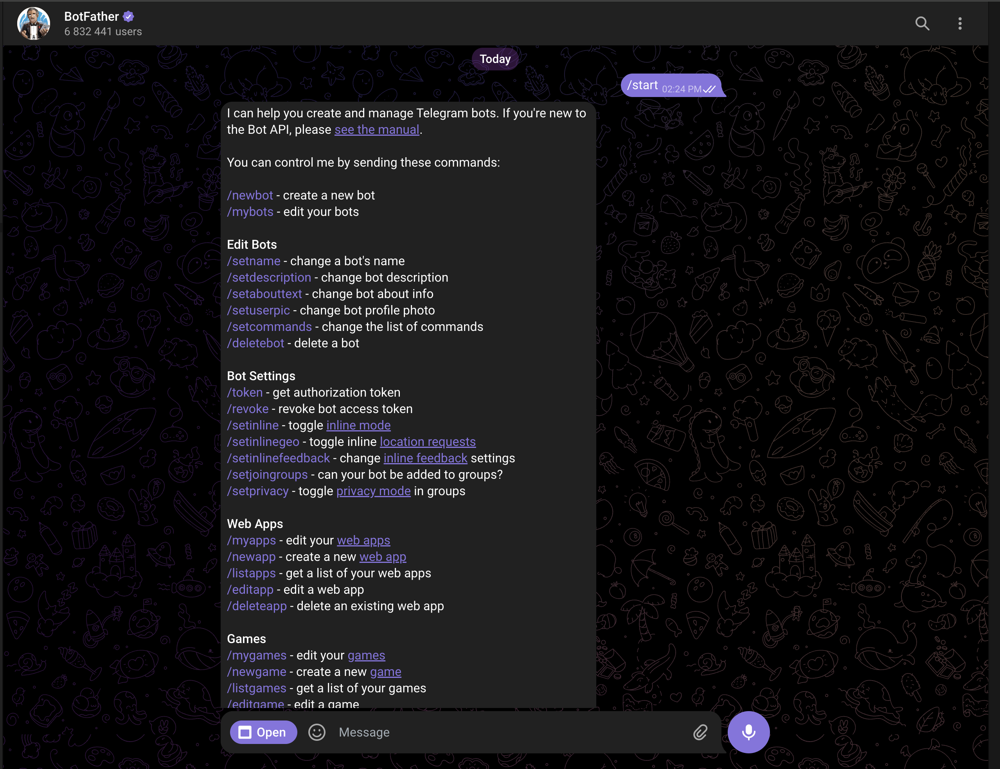
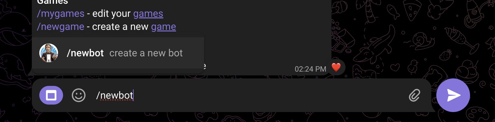
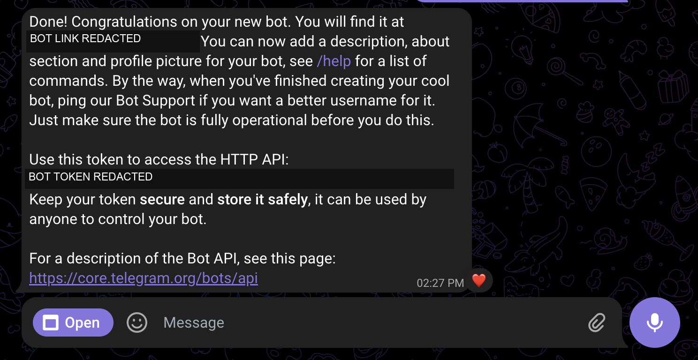

## Before you start

You need a Telegram account and permission to manage the employee's channels in Odella. Use a bot dedicated to the intended employee/channel rather than sharing one bot token across multiple webhook destinations.

The screenshots are existing setup illustrations. The example bot link and token are redacted; create and use your own bot.

## 1. Create the bot

Open the official [@BotFather](https://t.me/BotFather), verify that it is the official account, and send `/newbot`.

<Frame caption="BotFather starts Telegram bot creation.">
  
</Frame>
<Frame caption="Send the newbot command to the official BotFather.">
  
</Frame>

Provide a display name, then an available username ending in `bot`. The Odella guide suggests a username, but Telegram determines whether it is available.

## 2. Add the token securely

BotFather returns a bot token. Copy it only into **Telegram Bot Token** in the employee's Telegram channel editor. Do not paste it into a normal conversation or share it in screenshots.

<Frame caption="Example creation result. The entire token and example bot link have been redacted.">
  
</Frame>

## 3. Create the Odella channel

Select **Create** once the token is present. Odella checks the bot identity and connects its incoming-message webhook. It also attempts to apply the employee's profile and register supported commands. A profile/command update is not the same as verified message delivery.

The bot username is derived from Telegram during activation. Use the username/link shown after successful setup, not a guess based on the employee's name.

## 4. Test a direct conversation

Open the bot in Telegram, select **Start**, and send a low-risk request from an allowed contact. Confirm the reply and employee Activity. Before adding the bot to groups, review group permissions and the employee's access/security settings.

The in-app guide describes `/setprivacy` for optional group behavior. Changing Telegram's privacy mode broadens what the bot may receive; it is not needed for the initial direct-message test. Have the responsible human review it rather than changing it from a configuration conversation. Provider privacy mode and Odella's own admission rules both apply.

## Troubleshooting and maintenance

- **Invalid token:** confirm the token belongs to the intended bot. Use BotFather's supported token/revocation controls if recovery is needed.
- **No inbound messages:** check publication, webhook configuration, whether another service has taken over the same bot's webhook, sender access and Activity.
- **Direct messages work but a group does not:** check group membership, mention/privacy behavior and employee policy; do not disable policy just to pass the test.
- **Token rotated:** update it securely and ensure the webhook/connection is re-established. A saved token alone is not proof of reconnection; ask support if the supported flow does not offer a retry.

Deleting this channel attempts to remove its Telegram webhook. It does not delete the bot in BotFather or undo messages already sent. Provider accounts and Odella work remain subject to their own terms and usage limits.
