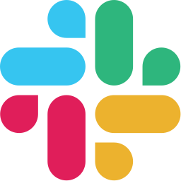
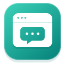
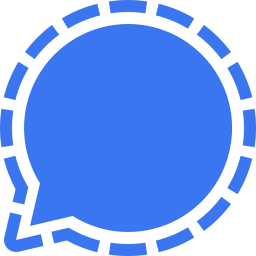

A communication channel gives an AI Employee a contact point. A toolkit lets the employee act in another application. Connecting one does not automatically configure the other.

Already connected? [Contact an employee through channels](/workforce/contact-an-employee) explains how to start a conversation and handle requests for review. The guides below are for setting up a channel.

## Choose the right setup guide

{/* channel-branding:start — generated by scripts/sync-channel-branding.mjs */}

  <a className="channel-logo-card" data-channel="slack" href="/workforce/channels/slack">
    
      
      Slack
      →
    
    Create the workspace app, add credentials securely, and approve its installation.
  </a>
  <a className="channel-logo-card" data-channel="teams" href="/workforce/channels/teams">
    
      
      Microsoft Teams
      →
    
    Register the Microsoft app, configure the bot, and install the Teams package with administrator help.
  </a>
  <a className="channel-logo-card" data-channel="email" href="/workforce/channels/email">
    
      
      Employee email
      →
    
    Use the employee’s generated Odella address. Incoming email is restricted to authorized members.
  </a>
  <a className="channel-logo-card" data-channel="web-chat" href="/workforce/channels/web-chat">
    
      
      Web chat
      →
    
    Configure the employee’s existing Odella conversation and optional spoken replies.
  </a>
  <a className="channel-logo-card" data-channel="whatsapp" href="/workforce/channels/whatsapp">
    
      
      WhatsApp
      →
    
    Review organization eligibility, an assigned number, and manual/provider onboarding. Not fully self-service.
  </a>
  <a className="channel-logo-card" data-channel="phone" href="/workforce/channels/phone">
    
      
      Phone and SMS
      →
    
    Assign an active, capable number and verify eligibility, compliance, routing, and calling terms.
  </a>
  <a className="channel-logo-card" data-channel="telegram" href="/workforce/channels/telegram">
    
      
      Telegram
      →
    
    Create the bot with the official BotFather, save its token securely, and test a message.
  </a>
  <a className="channel-logo-card" data-channel="discord" href="/workforce/channels/discord">
    
      
      Discord
      →
    
    Configure a developer application, bot token, gateway intents, and server installation.
  </a>
  <a className="channel-logo-card" data-channel="signal" href="/workforce/channels/signal">
    
      
      Signal
      →
    
    Use a supported assigned number, complete SMS verification, and resolve a CAPTCHA when needed.
  </a>
  <a className="channel-logo-card" data-channel="google-meet" href="/workforce/channels/google-meet">
    
      
      Google Meet
      →
    
    Confirm availability and Google authorization with support. A saved meeting link is not proof of access.
  </a>

{/* channel-branding:end */}

<Note>
  Channel availability depends on your account, permissions, current plan and
  deployed product. WhatsApp entry points differ: the add-capability panel
  includes an organization-only option while the employee skill graph hides it.
  Meet is not listed in normal picker metadata. An integration or backend
  feature with the same name does not prove that channel setup is available.
</Note>

For a direct browser voice conversation where available, see [Talk](/workforce/talk). Browser Talk is separate from channel text-to-speech, telephone calls and meeting participation.

## Common setup path

1. Open **Workforce**, select the intended employee and open its **Channels** capability.
2. Choose the supported channel or edit the employee's existing channel. Default web/email channels should not be duplicated.
3. Follow the channel guide, using the manifest, endpoint, package or number generated for this employee and environment.
4. Complete any external administrator approval, secure credential entry, provider verification or number-compliance check. A draft or submitted request is not a working connection.
5. Review security and **Channel Access** in the employee UI. Publication does not override sender restrictions, approvals or working hours.
6. Complete the offered **Create**, authorization or publication flow. Confirm the actual provider/registration result, not just a saved form.
7. With the participant's permission, test a low-risk message/call and check the reply and employee Activity before wider use.

## What “ready” means

Check these separately: configuration saved, required provider consent/verification complete, published in Odella, correct provider installation/routing, allowed sender, employee available, and end-to-end delivery verified.

WhatsApp may be published while provider registration is pending. Teams may be published before its package is installed. A Signal verification request is not an active registration. A saved Meet link is not Google authorization or proof of live attendance.

## Credentials and protected settings

Never paste bot tokens, signing/client secrets, verification codes or configuration tokens into ordinary conversations. Use the dedicated secure fields/consent steps. Setup illustrations may be historical; redacted values are not examples to copy.

Memory settings, dreaming and security policies must be changed by opening the employee UI, not through a conversation. Read [Security & Privacy](/workforce/settings-security-privacy). Approving one message or enabling a non-security presentation option is not permission to weaken a saved policy.

## Access is separate from publication

[Governance](/workforce/governance) determines who can use or edit the employee in your organization. [Security & Privacy](/workforce/settings-security-privacy) controls inbound access, outbound messaging and tool approvals.

A published channel can still refuse a sender under its access policy. Being allowed to contact the employee does not grant unrestricted permission for it to contact someone else.

## Billing, changes and removal

Phone numbers, calls, work, provider subscriptions and paid channels can have separate eligibility and charges. Check **Account → Limits** and the current costs before approval; do not infer that saving configuration starts a free service.

Before changing credentials or removing a channel, review Actions, expected incoming messages and other channels sharing a number. The existing editor may offer **Delete** for optional channels; it is not a guarantee of a pause/unpublish lifecycle or provider uninstall. Default web/email channels are protected. Removal does not undo sent messages, delete provider bots or necessarily release a billed number.

If a test fails, check account/employee selection, provider setup, registration/publication, routing/install permissions, allowed sender, employee availability, pending approvals and Activity. Escalate with a redacted error and the setup stage, never the credential value.
