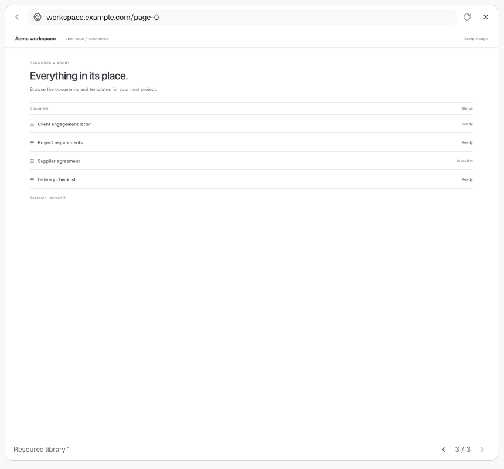

When an AI Employee uses a remote browser, the conversation can show that work in the **Computer** canvas. This is the employee's browser session—not a view of your own computer's desktop. Browser, terminal, file and document panels are distinct parts of the workspace.

<Note>
  Browser availability depends on the employee, account, permissions and active session. An old screenshot or activity item does not prove there is a browser you can control now.
</Note>

<Frame caption="A sign-in handoff in Computer, with browser, terminal, and hand-back controls. Actual Odella UI with a fictional portal and synthetic task data; not a live session.">
  
</Frame>

## Respond to a browser handoff

An AI Employee may ask you to handle a password, multifactor authentication (MFA), a CAPTCHA, or another step that needs you. Use the handoff in the conversation rather than sending credentials in a message. If the request arrives through email or messaging, follow its review link into signed-in Odella.

1. Read the request and confirm which employee, destination and task it concerns.
2. Select **Open browser** in the conversation's handoff card. Standalone approval views may show an in-place preview instead.
3. Review the actual page and destination. Select **Take over** when offered to interact with the live page.
4. Complete only the necessary step yourself—for example, enter your password on the verified provider's page, answer MFA, complete a CAPTCHA, or review consent. Do not put passwords, recovery codes or one-time codes in chat. Complete verification normally; do not bypass the provider's checks.
5. Select **I'm done** to hand the reviewed session back. The handoff should then report **Done · handed back**. This resolves the handoff, not the whole task.
6. Choose **Skip** if you cannot or should not complete it. Tell the employee what is blocked without sharing secrets.

**Hand back**, where shown outside an active request, releases your browser control. For a waiting handoff, use **I'm done** to tell the worker you have finished, or **Skip** if you cannot complete it. Releasing control alone is not evidence that sign-in succeeded.

A handoff does not authorize every subsequent send, purchase, signing invitation or destructive action. Review separate [approval requests](/workforce/approvals) as they arise. An employee can prepare a signing request but cannot sign as you.

## Use a saved password

During a sign-in handoff, **Use a saved login** appears when your personal Vault has a matching login for the current HTTPS site and the feature is available.

1. Check the destination and open **Use a saved login**.
2. Select the intended login by title. The saved values are filled into the matching browser page, not sent as a chat message.
3. Inspect the page, finish any MFA or CAPTCHA yourself, and select **I'm done** when the required step is complete.

If the site changes or no suitable sign-in form is found, filling may fail. Open the correct sign-in page or complete the step yourself. Selecting a saved login is not proof that the provider accepted it.

## Save a password to Vault

When a supported handoff captures a login, an optional **Save login for [site]?** prompt can appear after you hand the browser back. Check the site and username, then choose **Save**, **Update** for an existing login, or **Not now**. Wait for **Saved to your Vault** before assuming the password was stored. The worker can continue while this optional prompt is waiting; not every sign-in offers it.

You can also add a login yourself under **Account → Vault → New item → Login**, using the exact HTTPS website, username, and password. If the worker presents a separate credential request, choose **Save in Vault** and complete the protected form, or **I don't have it** if you cannot provide it. Do not paste the password into the conversation.

Saved passwords belong to your [personal Vault](/platform/vault#saved-logins). They are not API-key grants to a worker. Saving a password does not itself sign in, authorize future external actions, or share your Vault with the whole team. After you hand back, the worker can read and use the resulting signed-in page within the browser's access boundaries.

## Saved website sessions are separate

Browser sign-ins may persist for later work. Review **Account → Vault → Browser sign-ins** and use **Sign out of all sites** if you want the saved session state cleared. This is separate from deleting a saved password, revoking an API key at its provider, or disconnecting a catalog integration.

## Inspect progress and results

Keep the conversation and [task state](/workforce/tasks) as the operational record. A rendered browser page, successful click, or terminal command is not proof that the business outcome completed. Check the resulting record, file, or confirmed task output.

Past browser captures and replay controls, when offered, show historical activity. They are not live control or a guarantee that an action can be undone. Do not type secrets into historical views or infer a provider's current state from a replay.

## Recovery

- **Browser closed:** Ask the employee to reopen the appropriate work; do not reuse an unrelated session.
- **View disconnected or stale:** Reopen the current Computer surface and wait for its reported connection state before interacting.
- **No permission to answer:** Ask the intended approver; access to a conversation does not grant approval authority.
- **Login failed:** Check the real provider, account and MFA step. Do not repeatedly share credentials or bypass verification.
- **Unsure whether an action succeeded:** Check the provider and current task before asking the employee to repeat it.

For browser voice calls and returned-document review, see [Talk](/workforce/talk); these are separate from taking control of a remote browser.
