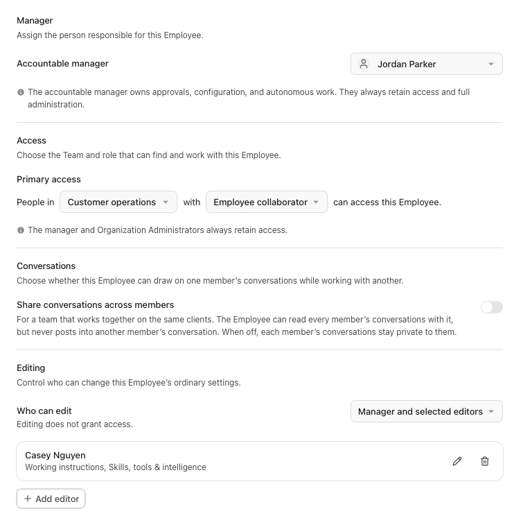

In an organization account, open the AI Employee's **Settings → Governance**. Governance controls are separate from the worker's channel access and tool approval policy.

You need the appropriate management permissions to change these settings. Some controls may remain read-only even when you can edit other worker settings.

<Frame caption="Restricted editing in the Governance panel, shown with Storybook example data.">
  
</Frame>

<Tip>
  New to team-based access? Follow [Create a team-restricted AI
  Employee](/platform/secure-employee-tutorial) to create the team, assign a
  permission role to its members, and test this panel's access rules.
</Tip>

## Assign an accountable manager

Choose the account member responsible for the worker. The manager owns approvals, configuration, and autonomous work, and retains access and full worker administration. Organization administrators also retain access.

This is an authorization responsibility, not just descriptive profile metadata. It does not grant unrelated billing permissions or access to every connected provider account.

For governed unattended work, the manager also supplies the user scope for user-based connections. Vault API keys still require explicit sharing with the worker; a manager assignment does not share every credential or lend the work the manager's unrestricted permissions.

Reassign the manager deliberately during handovers. Changing the manager revokes affected automation grants, so review and reauthorize unattended work rather than assuming it continues unchanged. If the current assignment is unavailable or requires reassignment, resolve that state before relying on unattended work.

See [Manager responsibilities](/workforce/manager-responsibilities) for the manager's authority and handover checklist, and [Credentials and user scope](/platform/credentials-and-scope) for how connection ownership is selected.

## Choose primary access

Under **Access**, select the audience and role requirements offered by the panel. For example, limit a customer-service worker to a particular team and qualifying role.

The team and role selectors form the primary access rule. **Any compatible role** does not mean everyone has every capability; the applicable role still needs to permit the requested operation. To require a particular team role, choose it explicitly. Only roles with **View employee** and a type compatible with the audience scope are offered.

You assign the permission role to people inside the team, not to the AI Employee as its job title. Creating a team or role alone does not restrict a worker until you configure this audience.

Review the resulting audience before saving. A person outside it does not gain worker access just because you later add them as an editor. The accountable manager and people with broad employee-administration access retain applicable access. See [How access control works](/platform/access-control).

## Control conversation sharing

**Share conversations across members** determines whether this worker can draw on one member's conversations while working with another.

- **Off:** Each member's conversations with the worker stay private from other members' worker context.
- **On:** The worker can read members' conversations with it while helping others. It does not post into another member's conversation.

Enable this only when cross-member context is appropriate for the team's work and privacy requirements. Review organization-level privacy controls too; this setting is not permission to share information through every channel.

## Restrict editing

Under **Who can edit**, choose **Everyone with access** or **Manager and selected editors**. To restrict editing to the manager and authorized organization administrators, choose **Manager and selected editors** and remove any additional editors. Selected editors can be people or team-role combinations.

Editing can be limited by area:

| Area                             | Examples                                              |
| -------------------------------- | ----------------------------------------------------- |
| **Profile & identity**           | Name, role, purpose, personality, voice.              |
| **Working instructions**         | Durable work and communication guidance.              |
| **Skills, tools & intelligence** | Models, memory, skills, tools, and supporting files.  |
| **Schedule & availability**      | Working hours, timezone, language, regional settings. |
| **Who can contact the Employee** | Connected inboxes and inbound access.                 |
| **Sending & approvals**          | Outbound messaging, tool approvals, recipient rules.  |
| **Automations & recurring work** | Scheduled and event-based actions.                    |

<Note>
  Editing permission does not grant access. Check both the audience and editing
  rules when a colleague cannot change a worker's settings.
</Note>

## Save and test

Select **Save Changes**, then verify the intended people can access the worker and only edit the areas they need. Confirm the manager and conversation-sharing choice after saving.

For a complete setup, also review [Organization roles](/platform/roles-and-permissions), [Security & Privacy](/workforce/settings-security-privacy), and [Approvals](/workforce/approvals).
