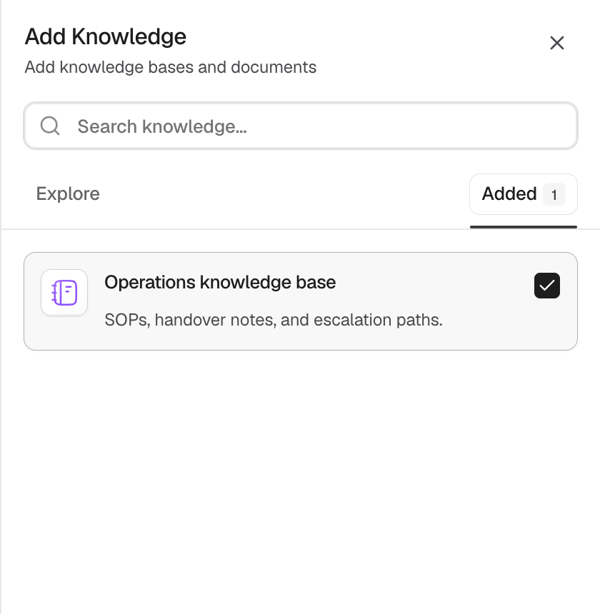

Knowledge gives a worker access to source material it can search and reference while working.

This is how you ground a worker in your organization's policies, precedent, files, and reusable context.

## What knowledge gives a worker

Connected knowledge can help a worker:

- Answer questions from approved source material
- Follow company policies or procedures
- Use precedent language
- Compare documents against internal standards
- Find relevant context before running a workflow

## What to connect

Good knowledge sources include:

- Policy libraries
- Matter or project references
- Precedent documents
- Standard operating procedures
- Product or service documentation
- Internal FAQs

## How knowledge appears in the skill tree

Knowledge bases and document stores appear as connected resources in the skill tree. Private stores can be opened from the skill tree for review.

1. Open the employee's **Skills** view and select **Knowledge** to open **Add Knowledge**.
2. Search for the approved store. Review its purpose and access before selecting it.
3. Select only the relevant stores, then use **Add Knowledge** to confirm the pending selections.
4. Check **Added** and the employee's connected resources. Test a question whose answer is in the store and review the cited source.

<Frame caption="Cropped actual Add Knowledge picker on Added, showing a synthetic existing assignment. Use Explore for new selections. Assignment and access to the underlying store remain separate checks.">
  
</Frame>

## Workspace vs. knowledge

Use **Knowledge** for reusable, governed source material.

Use **Workspace** for files the worker is actively handling, such as drafts, one-off uploads, or task-specific working files.

<Warning>
Avoid connecting broad or irrelevant knowledge bases. Too much unrelated context can make worker outputs less focused.
</Warning>