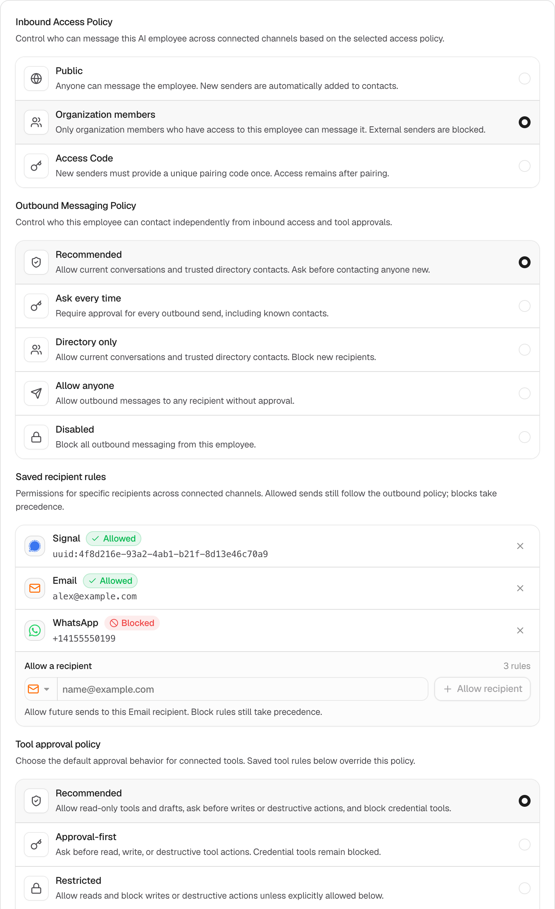

**Security & Privacy** separates three decisions: who may contact the worker, who the worker may contact, and what connected tools it may use.

For the actual review-and-resolve process, see [Approvals](/workforce/approvals). To control who can use or edit the worker inside your organization, see [Governance](/workforce/governance). Those settings are separate from channel and tool policies.

<Note>
  These connected-tool and messaging controls are not a universal browser-action
  or network-egress policy. Read [Tool and browser
  boundaries](/platform/tool-and-browser-security), then follow the [secure
  setup tutorial](/platform/secure-employee-tutorial) to verify your
  configuration.
</Note>

<Frame caption="Cropped actual Security & Privacy controls with synthetic saved recipients. Example rules and selections are not live permissions or universal browser-action controls.">
  
</Frame>

## Inbound Access Policy

| Policy              | What it does                                                                                                                            |
| ------------------- | --------------------------------------------------------------------------------------------------------------------------------------- |
| **Public**          | Anyone can message the worker. New senders are automatically added to contacts.                                                         |
| **Organization members / Only you** | In an organization, only members with access to the worker can message it. In a personal account, the label is **Only you**. External senders are blocked. This is the default.                       |
| **Access Code**     | New senders must provide a unique pairing code once. Access remains after pairing. Selecting this option opens the access-code manager. |

Inbound access does not grant outbound permission and does not override tool approvals.

## Outbound Messaging Policy

| Policy             | What it does                                                                                                                                 |
| ------------------ | -------------------------------------------------------------------------------------------------------------------------------------------- |
| **Recommended**    | Allows replies in current conversations and messages to trusted directory contacts. Asks before contacting someone new. This is the default. |
| **Ask every time** | Requires approval for every outbound message, including known contacts.                                                                      |
| **Directory only** | Allows current conversations and trusted directory contacts, but blocks new recipients.                                                      |
| **Allow anyone**   | Allows outbound messages to any recipient without approval.                                                                                  |
| **Disabled**       | Blocks all outbound messaging from the worker.                                                                                               |

## Saved recipient rules

Recipient rules are explicit exceptions saved by channel and recipient address.

- An **allow** rule pre-approves that recipient, which is useful for a scheduled report sent to a fixed email address.
- A **block** rule prevents the worker from contacting that recipient.
- A recipient cannot be both allowed and blocked. Remove the block before adding an allow rule.
- Rules can be added in advance or saved when a team member approves a send.

Saved recipient rules work with the selected outbound policy; they do not change who may contact the worker.

## Tool approval policy

| Policy             | Read actions                       | Write actions                      | External sends        | Destructive actions   | Credential actions |
| ------------------ | ---------------------------------- | ---------------------------------- | --------------------- | --------------------- | ------------------ |
| **Recommended**    | Allow                              | Ask                                | Ask                   | Ask                   | Block              |
| **Approval-first** | Ask                                | Ask                                | Ask                   | Ask                   | Block              |
| **Restricted**     | Allow                              | Block                              | Block                 | Block                 | Block              |
| **Unrestricted**   | Do not use as an approval boundary | Do not use as an approval boundary | Verify exact behavior | Verify exact behavior | Block              |

**Recommended** is the default. The table summarizes ordinary action categories; saved exceptions and separate classifications for drafts and low-risk actions can change the result.

<Warning>
  Do not use **Unrestricted** when approval for sends or destructive actions is
  a security requirement. Verify the exact operation before production use.
  Prefer **Approval-first** for review-led pilots or **Restricted** to block
  ordinary writes, and review saved allow exceptions under either policy.
</Warning>

## Saved tool rules

Saved rules override the default tool policy for a specific connected tool:

- **Always allow** lets the worker use that tool without asking where the action is eligible to be allowed.
- **Always block** prevents the worker from using that tool.
- A choice saved during an approval can appear here automatically.
- Removing a saved rule returns the tool to the selected default policy.

<Warning>
  Review allow rules carefully for tools that send messages, edit production
  systems, manage sensitive data, or delete records. Use the narrowest policy
  that still lets the worker complete its responsibilities.
</Warning>
