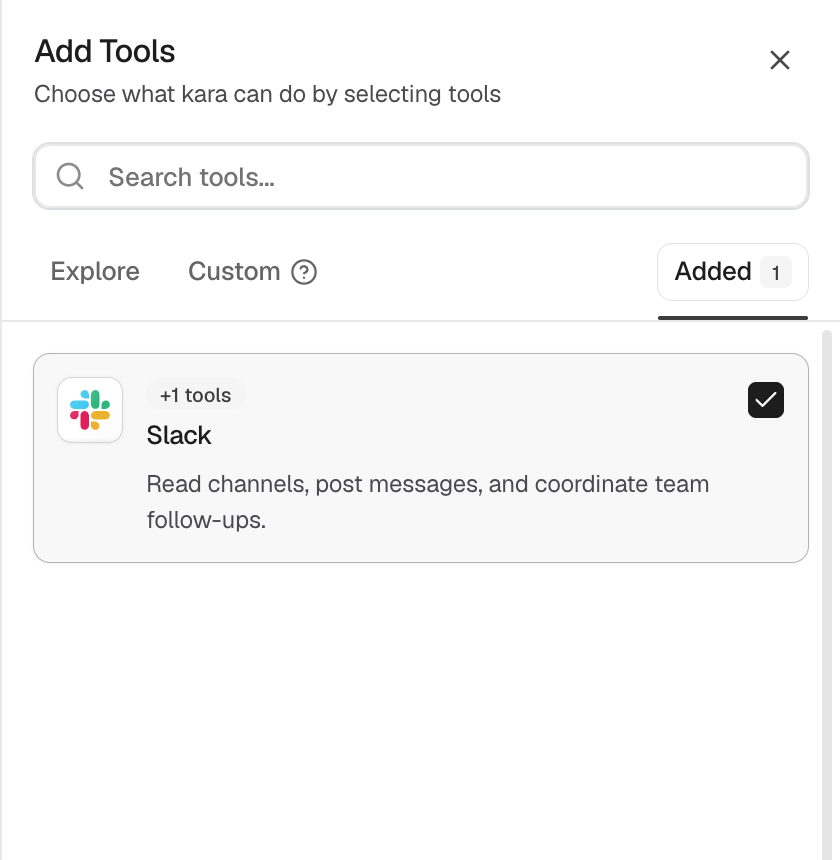
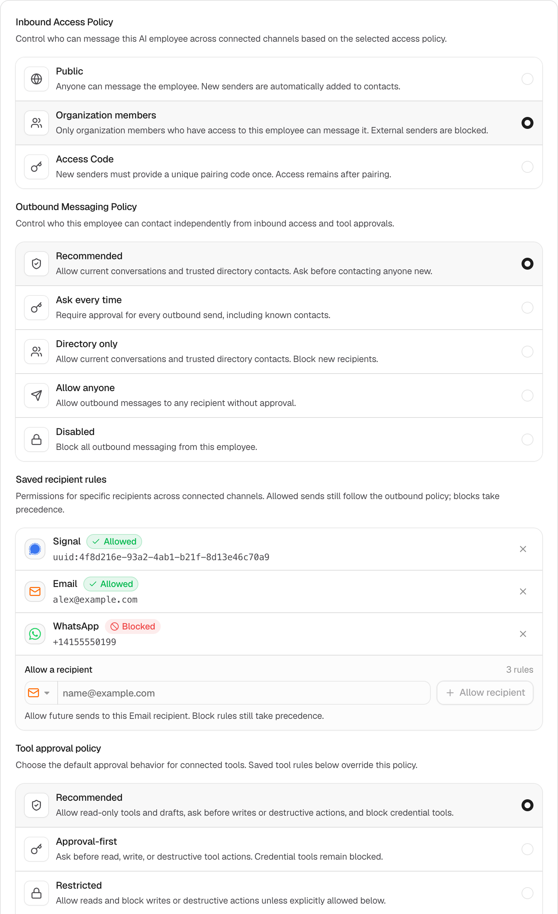

Tools let a worker interact with external systems. They are usually grouped into toolkits, such as a provider or service-specific collection of actions.

Tools let a worker read information or perform approved actions in connected systems.

## What tools can enable

Depending on the connected application, tools can let a worker:

- Read records or messages
- Search external systems
- Draft updates
- Send messages
- Create or edit records
- Upload or download files
- Trigger provider-specific actions

## Toolkits

A toolkit is a group of related tools. For example, a toolkit might contain several actions for one provider or one business system.

In the skill tree, toolkits show which groups of tools the worker can use.

## Required applications

When a worker needs external tools, the required application appears in the sidebar's **Applications** section. Connect the application before expecting the worker to use those tools successfully.

## Assign a toolkit

1. Connect the approved provider account in [Integrations](/integrations/overview). Confirm whose connection will be used for the work.
2. Open the employee's **Skills** view and select **Tools**.
3. Review the toolkit and its connection state, select what the worker needs, and confirm with **Add Tools**. Use **Added** to inspect existing assignments.
4. Review the employee's tool approval policy, then test one low-risk operation. A connected toolkit is not permission for every operation at the provider.

<Frame caption="Cropped actual Add Tools picker on Added with a synthetic Slack assignment. Use Explore for new selections. Connection indicators are examples, not live authorizations.">
  
</Frame>

## Security and approvals

Tool behavior is governed by the worker's **Tool approval policy** in Settings.

Policies can allow, ask, or block categories such as reads, writes, external sends, destructive actions, and credential-related tools. Saved tool rules can override the default policy for specific tools.

<Frame caption="Cropped actual Security & Privacy controls with synthetic recipient rules. These example settings are not a recommended policy for every worker.">
  
</Frame>

<Warning>
Be careful with tools that send external messages, edit production data, manage credentials, or delete records. Use approval-first or restricted policies for sensitive workers.
</Warning>