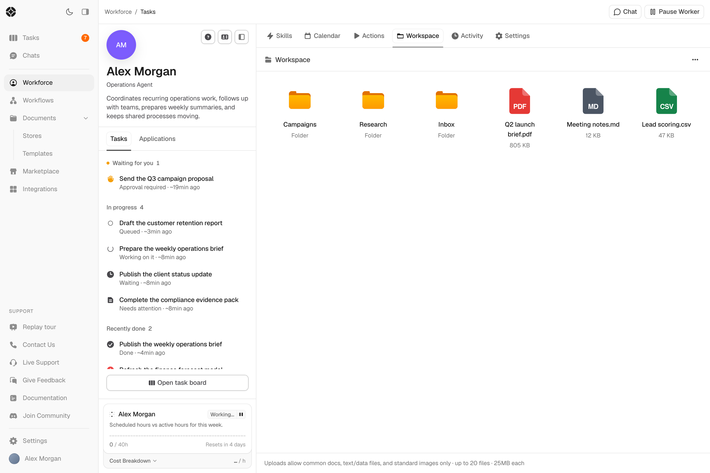

**Workspace** is the worker's private file area. Use it for files the worker needs while doing day-to-day work, such as inputs, drafts, exports, notes, and temporary reference material.

Workspace supports common document, text, data, and image files. Upload limits are enforced by file type, file count, and file size.

<Frame caption="The actual employee Workspace with fictional folders and working files. Synthetic Storybook example; no customer documents are shown.">
  
</Frame>

## Start with one working file

1. Open the employee's **Workspace** tab and the intended folder.
2. Upload a harmless example file using the upload area or drag and drop. Wait for it to appear before asking the worker to use it.
3. Open the file or its available actions to preview or download it. Check the returned file itself, not only a task summary.
4. Keep reusable company reference material in a [Document Store](/documents/overview) instead of treating a temporary upload as shared knowledge.

## What you can do

| Action | What it does |
| --- | --- |
| **Upload files** | Adds files to the current folder. You can upload manually or drag and drop. |
| **Create folder** | Adds a folder for organizing files. |
| **Refresh** | Reloads the current folder. |
| **Preview** | Opens supported files, including text, PDF, and DOCX files. |
| **Download** | Downloads a selected file. |
| **Copy path** | Copies the workspace path for a file or folder. |
| **Rename** | Changes the name of a file or folder. |
| **Move** | Moves files or folders between workspace folders. |
| **Delete** | Removes a selected file or folder after confirmation. |
| **Clear workspace** | Removes workspace contents after confirmation. |

## When to use Workspace

Use Workspace for operational files tied to this worker's current work.

Good examples:

- A spreadsheet to review
- A PDF to summarize
- A draft report
- A folder of exported files
- Temporary notes for an active matter or project

## Workspace vs. knowledge bases

Workspace files are useful working files. They are not the best place for reusable, governed knowledge.

Use **Document Stores** or knowledge bases for material that should be searchable, reusable, and managed across the organization.

<Warning>
Clearing or deleting workspace files is destructive. Download anything important before removing it.
</Warning>